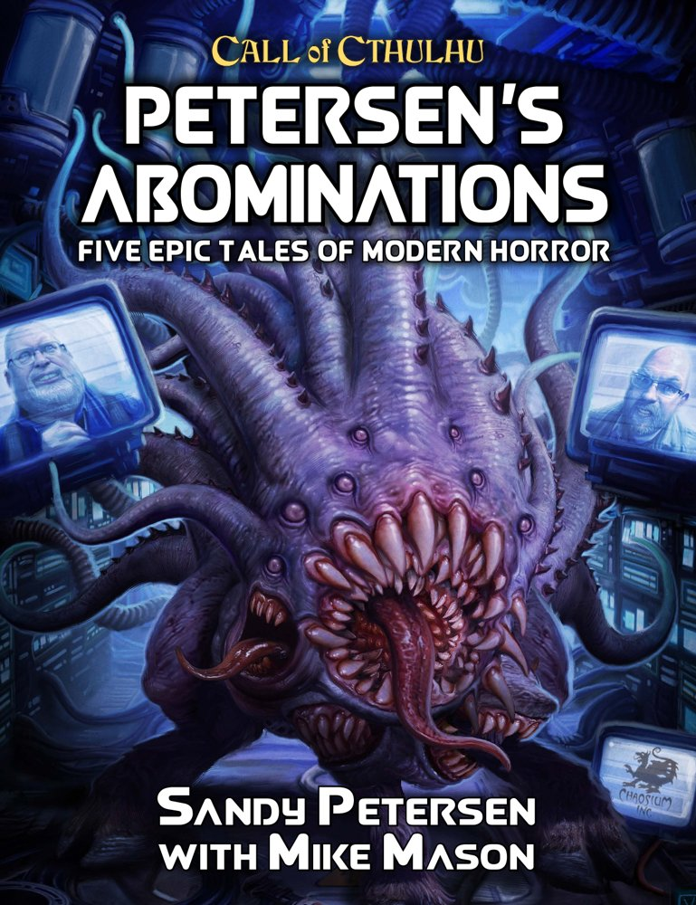

Зов Ктулху

КОШМАРЫ ЦИФРОВОЙ ЭПОХИ

Пять эпических историй современного ужаса

Сэнди Петерсен при участии Майка Мейсона

*На обложке (худ. Виктор Леса) — многоглазое зубастое чудовище со щупальцами посреди серверной: вокруг мониторы, на двух из них — лица авторов, на третьем — логотип Chaosium. Вверху — «Call of Cthulhu», название «Petersen’s Abominations» и подзаголовок «Five Epic Tales of Modern Horror», внизу — «Sandy Petersen with Mike Mason».*
