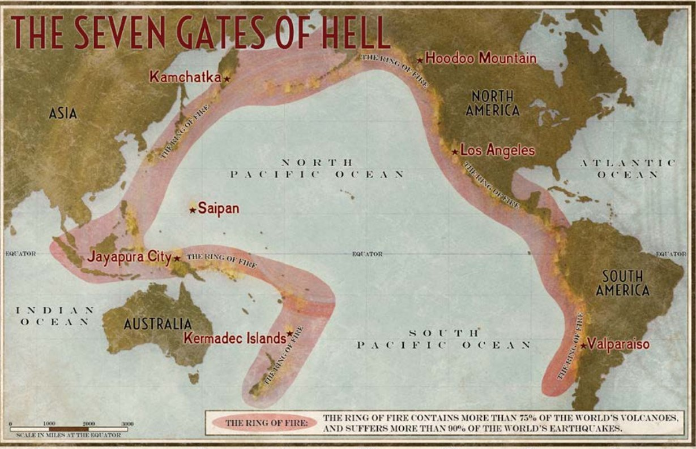

#### Семь врат ада

**Отель «Семь звёзд», Британская Колумбия**

- Восстают мертвецы. Извергается гора Худу.

**Коммерс, округ Лос-Анджелес, Калифорния**

- Город проваливается в огромную карстовую воронку, из которой выходят кормиться чудовища Мифов.

**Петропавловск-Камчатский, Камчатка, Россия**

- Все в радиусе 32 км внезапно и необъяснимо умирают. Извергается Авачинский вулкан.

**Джаяпура, столица Папуа, Новая Гвинея**

- Извергается вулкан; звёздные отродья и другие водные чудовища выходят кормиться.

**Острова Кермадек, Новая Зеландия**

- Стремительно распространяется болезнь, похожая на чуму, и вызывает массовое бегство с острова. Соседний остров Кертис уничтожен вулканическим взрывом.

**Сайпан, Марианские острова**

- Землетрясения и массовая паника. Извергается вулкан.

**Вальпараисо, Чили**

- Землетрясение. Упыри выходят кормиться.

> **Представления об аде**
>
> Представление об аде как о месте проклятия и страданий есть у многих народов мира. Каждая культура называет ад по-своему, но сходства между ними часто наводят на размышления. Авраамическая традиция видит в аде наказание. Каббала описывает ад как приёмную, преддверие для всех душ. В исламе Джаханнам — место пылающего огня, кипящей воды и мучений. Некоторые другие традиции, которым неизвестна загробная жизнь как место кары или награды, описывают ад как обиталище мёртвых.
>
> В Мифах Ктулху ад можно считать страшным измерением — воплощением полного запустения, настолько чуждым человечеству, что мы не в силах его постичь. Видения, встречи и предания, накопленные за века человеческой истории, общее восприятие сводит к образу зловещего места, где нет ничего доброго и куда грешников отправляют на веки вечные. Такие представления — способ, которым человечество справляется с правдой о космической реальности бытия и о вселенной, в которой, как нам кажется, мы существуем.

*Карта «Семь врат ада». Звёздами отмечены врата: Камчатка, гора Худу, Лос-Анджелес (Коммерс), Сайпан, Джаяпура, острова Кермадек, Вальпараисо. Подписи материков и океанов: Азия, Северная Америка, Южная Америка, Австралия, северная и южная часть Тихого океана, Атлантический океан, Индийский океан; линия «Огненное кольцо». Легенда: «В Огненном кольце находится более 75 % вулканов мира, и на него приходится более 90 % землетрясений Земли».*
