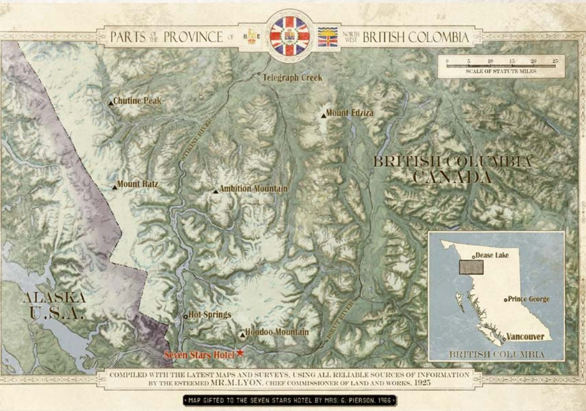

## Место действия

Ниже даны сведения о Британской Колумбии и окрестностях, подробное описание отеля «Семь звёзд», а также сведения о коренном народе этих мест и о приезжем проповеднике. Где нужно, указаны события, привязанные к ключевым местам, — используйте их вместе с набором возможных событий из раздела «Как вести сценарий» (с. 26). Сценарий устроен как «песочница»: игроки исследуют, а Хранитель откликается на их действия.

Действие «Адского отеля» разворачивается в чрезвычайно уединённой и далёкой глуши северо-западного угла Британской Колумбии (Канада). Отель стоит на реке Искут, в тени горы Худу, примерно в 997 км от Ванкувера, в 626 км от Принс-Джорджа (к югу) и в 30 км к востоку от впадения Искута в реку Стикин.

Ближайший городок, где можно раздобыть припасы, топливо и всё необходимое, — Телеграф-Крик (больше чем в 160 км к северу, на краю парка горы Эдзиза). Примерно в 112 км к северо-востоку от Телеграф-Крика и больше чем в 1600 км от Ванкувера лежит крошечный посёлок Диз-Лейк с ближайшим аэропортом. Вдоль южного течения реки Искут дорог нет.

> **Британская Колумбия**
>
> Британская Колумбия — самая западная провинция Канады. На южной её границе лежит Ванкувер, а на севере она граничит с Аляской и Юконом. Огромный, малонаселённый край, где господствуют горные хребты и ледники, может похвастаться великолепными видами; летом сюда едут те, кто ищет острых ощущений в диких местах — походов, кемпинга, горных лыж.
>
> Дорог здесь по большей части почти нет: в основную часть края на машине не попасть. Из-за раскинувшихся густых лесов, горных хребтов и отсутствия обустроенных троп лучше всего передвигаться на лодке или на самолёте. Сотовой связи практически нет (приезжим советуют брать с собой спутниковый телефон). Поэтому огромные области края необитаемы.
>
> Часто бывают густые туманы. Температура может сильно меняться: даже летом она может опускаться ниже 10 °C. В диком краю здесь легко заблудиться. Даже обычная прогулка требует учитывать погоду, а также другие опасности природы — например, чёрных медведей.
>
> **Хранителю на заметку:** в крае водится медведь Кермоде (его ещё называют «медведем-призраком») — подвид американского чёрного медведя; примерно у каждого десятого из-за редкого рецессивного гена белая шерсть (как у белого медведя). Эти белые медведи занимают важное место в устных преданиях коренных народов края.

*Карта северо-запада Британской Колумбии, стилизованная под старинную. Заголовок: «Части провинции Северо-Западная Британская Колумбия» (так, «Colombia»). Подписи: Телеграф-Крик, пик Чутин, гора Эдзиза, река Стикин, Британская Колумбия (Канада), гора Рац, гора Амбишн, Аляска (США), Горячие источники, река Искут, гора Худу, отель «Семь звёзд», Диз-Лейк, Принс-Джордж, Ванкувер. Надписи на полях: «Составлена по новейшим картам и съёмкам из всех надёжных источников уважаемым г-ном М. Лайоном, главным комиссаром по землям и работам, 1925» и «Карта подарена отелю „Семь звёзд“ миссис Г. Пирсон, 1966». Масштаб — в статутных милях (0–25; около 0–40 км).*
