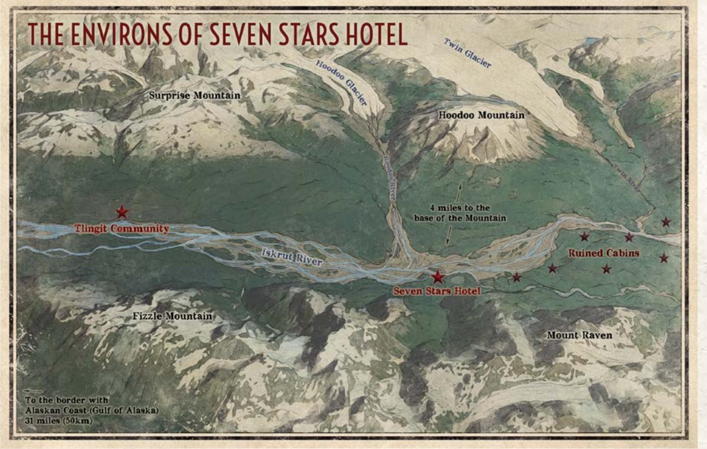

> *(Окончание врезки «Британская Колумбия».)* Если ввести в сценарий существо, похожее на белого медведя, у игроков может возникнуть немалое замешательство.

### Река Искут

Река Искут, крупнейший приток реки Стикин, течёт по северо-западу провинции. В ней водятся пять видов лосося, арктический хариус и радужная форель, а также многие другие рыбы. Вода ледяная, купаться не советуют: без подходящей одежды пловцам грозит переохлаждение.

## Тлинкиты и священник

Отель «Семь звёзд» стоит в глуши, но сыщики знают о тлинкитах, которые дают работников для ремонта здания. Следующие сведения пригодятся, если сыщики захотят побывать в местном посёлке или подробнее поговорить с кем-то из нанятых на работы в отеле.

Священник — евангелический проповедник из Техаса по имени Ребнеш — сейчас живёт у тлинкитов. Поначалу сыщики не знают о нём, пока либо не побывают в посёлке тлинкитов, либо проповедник сам не заглянет в отель.

> **Народ тлинкитов**
>
> Тлинкиты («Народ приливов») — коренной народ тихоокеанского северо-западного побережья. Посёлок тлинкитов стоит на северном берегу реки Искут, примерно в 16 км от отеля «Семь звёзд».
>
> Родной язык тлинкитов — лингит, но говорят они и по-английски, так что объясниться с ними сыщикам будет нетрудно.
>
> Исторически тлинкиты жили по большим рекам края. С конца 1880-х многие тлинкиты приняли христианство. Впрочем, в последнее время среди молодёжи заметно стремление вернуться к более традиционным племенным верованиям. Большинство, в том числе многие старейшины, совмещают христианскую веру с традиционным мировоззрением своей культуры.
>
> Во многих ремёслах тлинкитов видна тесная связь искусства и духовности. Гости посёлка увидят тотемные столбы, каноэ, горшки и украшения — всё сделано с большим мастерством.
>
> Посёлок не особенно велик: в нём живут человек пятьдесят соплеменников, а также преподобный Ребнеш, евангелический проповедник, который поселился здесь около полугода назад. Некоторые тлинкиты даже помогают Ребнешу строить церковь рядом с посёлком. В остальном жители посёлка охотятся и выращивают еду, ездят на заработки по краю или работают проводниками у туристов и учёных, которые приезжают в эти места.

*Карта окрестностей отеля «Семь звёзд». Подписи: гора Сюрпрайз, ледник Худу, ледник Твин, гора Худу, река Худу, река Твин, «6 км до подножия горы», посёлок тлинкитов, река Искут (на карте — «Iskrut River»), отель «Семь звёзд», «Развалины хижин» (старательские хижины, отмечены звёздами), гора Физл, гора Рейвен, «К границе с побережьем Аляски».*

*Прим. перев.: на картах (с. 12, 16 оригинала) и на раздатке «Материал: отель 1» река подписана «Iskrut River» — опечатка; в тексте — Iskut (Искут).*
