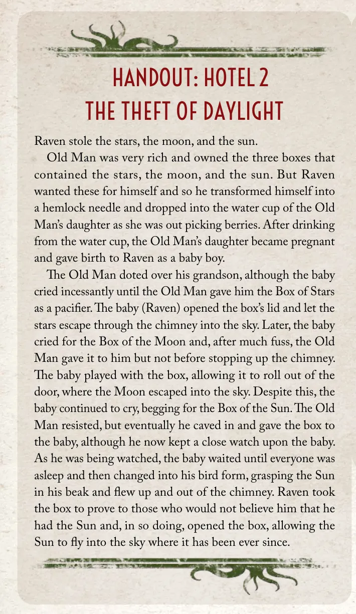

### Как тлинкиты относятся к сыщикам

Тлинкиты помогают сыщикам и идут им навстречу: ремонт отеля обещает так нужные им работу и заработок. К началу сценария сыщики уже связались с посёлком, и около десятка мужчин-тлинкитов наняты начинать восстановительные работы, а также собирать и подвозить на лодках стройматериалы. На протяжении всего сценария изображайте тлинкитов обычными людьми, которые охотно помогают и рады гостям.

По мере того как события нарастают, рабочие становятся настороженнее, но не считают сыщиков «смутьянами». Когда же начнётся настоящий ад, оставшиеся рабочие могут попытаться бежать в свой посёлок, примерно в 16 км вверх по реке. Хранитель решает, не преграждают ли им путь мертвецы (см. «События», с. 29).

### Что знают тлинкиты

Рабочие-тлинкиты могут подтвердить, что отель первым построил поселенец по фамилии Леви в середине 1860-х, во время золотой лихорадки на Стикине, что потом его закрыли, но позже перестроили под торговый пост и отель. С годами путешественников становилось всё меньше; в 1970-х заведение закрыли, а здание бросили. С тех пор им никто не пользовался.

Рабочие в отеле подробностей не помнят, но старейшины племени, если к ним обратиться, расскажут, что в 1920-х, незадолго до закрытия отеля, поселенцы убили там одного из своих. Подробности туманны. Старейшины могут сказать только, что человека обвинили в колдовстве и сожгли заживо. Ещё старейшины помнят, что однажды в эти места приезжал священник, чтобы построить церковь на месте старого отеля, но когда священника нашли со свёрнутой головой, от затеи с церковью отказались.

О горе Худу местные говорят неохотно, но если надавить, большинство скажет, что гора, по общему поверью, проклята. Успешная проверка Красноречия, Убеждения или Запугивания может заставить кого-нибудь из рабочих признаться, что на горе живут беспокойные духи, а тех, кто задерживается там слишком долго, мучают дурные сны.

Если спросить о легендах — особенно о конце света, вратах в ад и тому подобном, — старейшины племени с одинаковой готовностью процитируют и Евангелие, и племенные предания. Если убедить их успешной проверкой Обаяния или Убеждения, сыщикам расскажут историю о похищении солнечного света (см. «Материал: отель 2»). Это история о Вороне, который открывает короба со звёздами, луной и солнцем и выпускает их на небо.

Успешная проверка Оккультизма позволяет понять, что сказание — притча о сотворении небес, а успешная проверка Мифов Ктулху видит в Старике Азатота, а в Вороне — Ньярлатхотепа, создающего Солнечную систему, и подсказывает, что Солнце, Луну и Звёзды можно «вернуть в их короба» и так принести миру новую тьму, то есть конец Земли и её обитателей.

> **Раздатка «Материал: отель 2. Похищение солнечного света»**
>
> Как Ворон украл звёзды, луну и солнце.
>
> Старик был очень богат и владел тремя коробами, где лежали звёзды, луна и солнце. Но Ворон хотел забрать их себе, так что он превратился в сосновую иголку и прыгнул в чашку воды дочери Старика, когда она собирала ягоды. Выпив воды из чашки, дочь Старика забеременела и родила Ворона как маленького мальчика.
>
> Старик обожал внука, но ребёнок всё время безутешно плакал, пока Старик не дал ему поиграть короб со звёздами. Мальчик (Ворон) открыл короб, и звёзды через дымоход уплыли на небо. Через какое-то время ребёнок принялся плакать и просить дать ему короб с луной. Старик после долгих колебаний отдал его, но сначала заткнул дымоход. Мальчик стал играть с коробом, тот выкатился за дверь, и луна уплыла в небо. Но ребёнок продолжал плакать, требуя короб с солнцем. Старик долго отказывался, но в конце концов отдал короб мальчику и стал пристально за ним приглядывать. Мальчик же дождался, пока все заснут, а потом превратился в птицу, схватил короб клювом и вылетел наружу через дымоход. Ворон забрал короб, чтобы доказать всем, что у него есть солнце, но случайно открыл крышку, и солнце вылетело в небо, где и находится по сей день.

*Прим. перев.: текст раздатки — официальный русский перевод («Кошмары цифровой эпохи: материалы для игроков»); в оригинале Ворон превращается в иголку тсуги (hemlock needle).*

## Преподобный Ребнеш

Преподобный — пятидесятнический проповедник родом из Техаса. Он живёт у тлинкитов около полугода, окормляет общину и руководит постройкой нового здания церкви.

Ребнеш — проповедник в духе «геенны огненной»: несмотря на преклонные годы, он часто бывает громок и неистов. Поэтому сыщикам он может показаться слегка помешанным. Сыщики могут встретить его, если побывают в посёлке тлинкитов в начале сценария, но вероятнее, что
