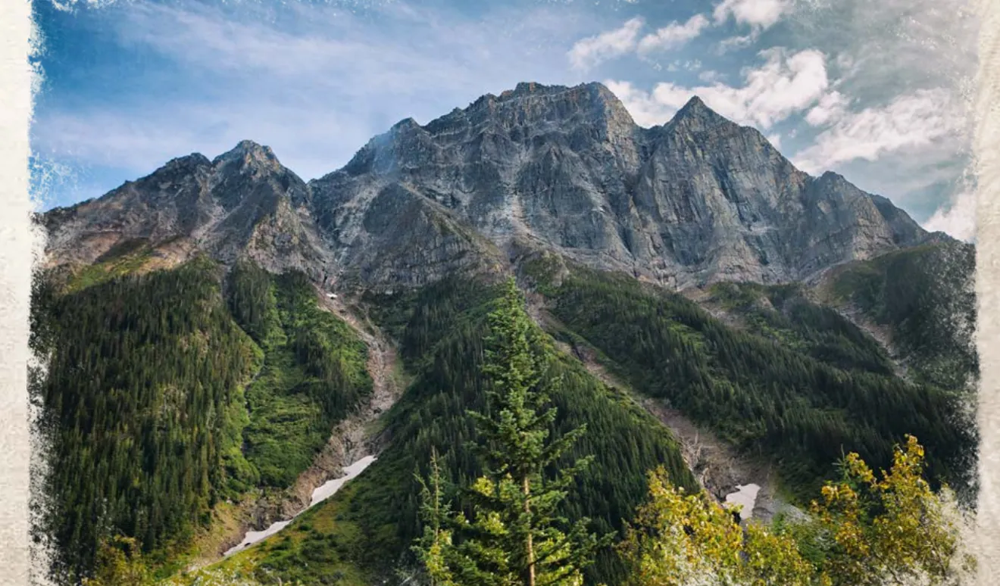

## Отель «Семь звёзд»

Здание знавало лучшие дни: долгие годы заброшенности и непогода сильно повредили и конструкцию, и фасад. Ясно, что предстоит много работы, прежде чем двери откроются для платёжеспособных гостей. Ниже подробно описаны участок и внутренние помещения.

### Снаружи

Отель стоит недалеко от южного берега реки Искут. Прогнивший, но ещё пригодный деревянный настил служит причалом для лодок. Растительность здесь скудная, но то, что есть, разрослось и запущено: отель окружают чахлые колючие кусты, а древние высокие деревья пронзают небо. Вдали над горизонтом господствует гора Худу.

В западном конце отеля стоит сарай, где сыщики сложили инструменты и припасы, а также генератор и топливо. С восточной стороны в землю врезаны прогнившие створки — люк, ведущий к жёлобу в подвал отеля, по которому можно сбрасывать вниз дрова и прочие припасы. Ржавая железная цепь с висячим замком не даёт открыть люк (трудная проверка Взлома или проверка СИЛ — с бонусной костью, если используют рычаг или инструмент).

Также в северо-восточном конце отеля растёт самое старое и большое дерево в округе. Это туя высотой почти 60 метров с широким основанием. Именно здесь толпа линчевателей убила Шигля: прибила его руки к дереву и засыпала негашёной известью, — и здесь же закопала его тело (кости можно найти, если копнуть на 2 метра вглубь, — см. «Завершение сценария», с. 31). Тем, кто захочет осмотреть дерево, следует пройти проверку Внимания, чтобы заметить два старых железных гвоздя, глубоко ушедших в ствол: за годы дерево обросло их, и видны только самые кончики. Рабочие-тлинкиты стараются обходить дерево стороной, хотя это едва заметно (трудная проверка Психологии, если сыщик прямо говорит, что наблюдает за рабочими снаружи отеля). Если спросить их об этом, рабочие скажут, что дерево очень старое и от него идут дурные «вибрации»: оно было свидетелем злых дел. Сыщики, которые в одиночку проводят время у дерева, рискуют увидеть видение: Шигль, прибитый к стволу, корчится в муках, сгорая от извести (проверка Рассудка, потеря 1/1d3).

Если переправиться через реку Искут и двигаться на запад, можно добраться до посёлка тлинкитов (см. «Народ тлинкитов», с. 12), а если идти на север, сыщики придут к горе Худу

*Подпись: «Леса Британской Колумбии».*
