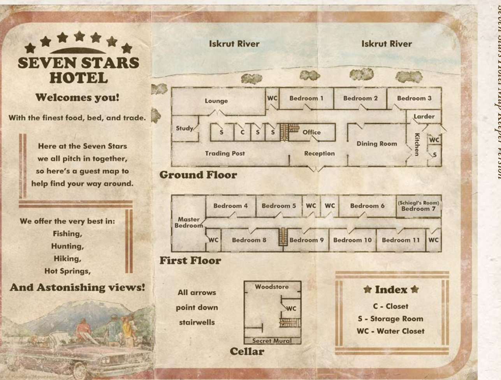

(см. «Гора Худу», с. 25). Если держаться южного берега реки и идти на восток, сыщики выйдут к нескольким развалившимся, давно брошенным деревянным хижинам (см. «Старательские хижины», с. 25). Учтите: берега реки почти свободны от растительности, но всего в нескольких метрах от воды начинаются деревья, переходящие в густой лес. Обычная прогулка по лесу не обязательно требует проверки навыка, чтобы найти дорогу обратно к отелю, но если сыщика преследуют или он в иной напряжённой ситуации, где легко потерять направление, может понадобиться проверка Ориентирования.

*План отеля «Семь звёзд» для Хранителя. Вверху — вид отеля, Горячие источники, гора Худу; по краям — река Искут (на плане — «Iskrut River»). Первый этаж: холл, уборная, номера 1, 2, 3, кладовка, библиотека, чуланы (Ч) и шкаф (Ш), офис, столовая, кухня, торговый пост, фойе. Второй этаж: номера 4, 5, уборные, номер 6, номер 7 (комната Шигля), хозяйская спальня, номера 8, 9, 10, 11. Подвал: склад поленьев, уборная, «Тайная фреска». Обозначения: Ш — шкаф, Ч — чулан, У — уборная; «Все стрелки указывают вниз по лестницам».*

### Внутри отеля

Двухэтажное здание с подвалом внутри в сравнительно хорошем состоянии — в отличие от того, как оно выглядит снаружи. Обстановка старая и выцветшая; обои ободраны, светильники (для свечей) либо пропали, либо сломаны. Там, где окна не заколочены, стёкла давно выбиты, и в некоторых комнатах похозяйничала непогода. Половицы в целом крепкие, однако сыщики и рабочие рискуют провалиться ногой сквозь гнилые трухлявые доски — по решению Хранителя. Повсюду пыль, грязь и паутина.

#### Первый этаж

Спереди — фойе, из которого можно пройти в общие помещения отеля (столовую, холл и библиотеку), а за ними — офис, чуланы и шкаф. Сзади — пять номеров. В восточном конце — кухня и кладовка. Почти в каждой комнате есть камин или печь. Ниже описаны ключевые помещения.

*Прим. перев.: так в оригинале — «пять номеров»; на плане и в описании ниже (номера 1–3) на первом этаже их три.*

**Старый торговый пост:** под истлевшими пыльными чехлами — остатки старого торгового поста, давно по большей части вывезенного. О прежнем назначении ещё говорят кое-какие вещи: пустые вёдра, старый прилавок, моток верёвки, несколько брошенных сломанных мётел, полотно лопаты и разные крюки, вбитые в стены. Среди хлама — неприятная находка: труп енота. На стене приколота старая фотография 1960-х годов: хозяева здания перед его фасадом.
