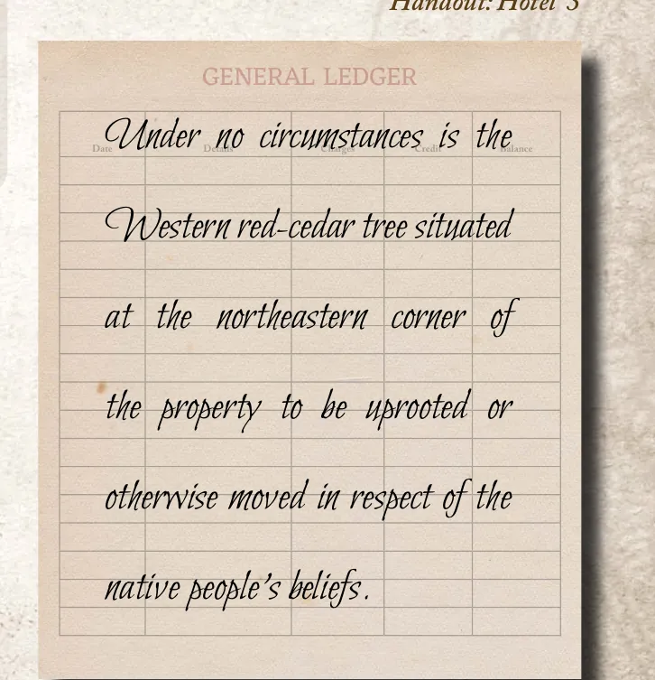

**Библиотека и холл:** книжные шкафы наполовину заполнены пыльными старыми книгами под слоем паутины. На полках валяются дохлые мухи. Если перебрать книги, найдутся две Библии, справочники по охоте и рыбалке, история Канады (написанная в 1970-х) и несколько книжек в мягких обложках. Удивительнее всего, пожалуй, количество старых книг по искусству: история искусства, написанная в конце 1800-х, папки с цветными гравюрами поздневикторианской эпохи и даже несколько старых альбомов с угольными набросками окрестностей.

Если посидеть над папками, пейзажи окажутся какими-то унылыми и почему-то нагоняют на зрителя тоску. В одном альбоме — весьма тревожные работы: сцены будто из безумного сна или кошмара, сцены смерти и пыток и то, что может быть изображением семи кругов ада. На одной чистой странице написано: «Горе тому, кто подойдёт близко, горе тому, кто откроет врата, ибо Зло будет выпущено в Мир». На всех альбомах стоят инициалы «J.S.». Некоторые работы датированы, примерно 1924–1925 годами.

**Столовая:** здесь дурно пахнет, и сюда, кажется, слетаются мухи. Старые деревянные столы и стулья накрыты пыльными чехлами. Успешная проверка Внимания позволяет заметить на полу свежую кровь, уходящую под один из чехлов. Под ним — труп (недавно умершего) енота: из раны на брюхе вывалились внутренности и начали гнить. Если внимательно осмотреть его намётанным глазом (медика, ветеринара или опытного охотника), станет ясно, что рана нанесена не чисто (как было бы с медвежьим когтем), а будто плоть разорвал длинный гвоздь.

**Кухня:** комнату занимает массивная дровяная плита, теперь покрытая пылью и паутиной. В остальном мебель — в основном деревянные разделочные столы. В комоде — кухонная утварь, в том числе набор ржавеющих кухонных ножей. Если развести в плите огонь, комнату вскоре заполнят клубы дыма: дымоход забит останками птиц, которые как-то оказались в нём в ловушке (сорок птиц в разной степени разложения — от скелетов до недавно погибших и гниющих).

**Кладовка при кухне:** дверь кладовки висит на одной петле; кто её тронет, на того она внезапно срывается и падает (проверка Уклонения, чтобы избежать 1 очка урона).

В кладовке поселился полосатый скунс; почувствовав угрозу от внезапно вошедшего сыщика, он может обрызгать его своей мерзкой пахучей жидкостью (струя бьёт до 6 метров) — особенно добрый Хранитель может позволить проверку Уклонения, чтобы избежать худшего. Попав в глаза, жидкость вызывает временное жжение (временная слепота на 4 раунда).

Внутри вдоль стен — пыльные полки; несколько старых жестяных банок с персиками и пара пустых ящиков из-под продуктов — вот и всё, что здесь можно найти. Если открыть банки с персиками, из них пахнёт жуткой вонью: внутри фрукты превратились в липкую чёрную жижу. В дальнем конце — бывший маленький холодильный чулан, теперь пустой.

**Офис:** обе комнаты офиса завалены всевозможным пыльным хламом — он разбросан по столам, громоздится на полу, набит в ящики и ячейки. В основном это коробки со старой керамикой, счета и бумаги, бухгалтерские книги, высохшие чернильницы и тому подобное. Если порыться в этом беспорядке, найдутся пожелтевшие гостевые книги; имена и места жительства гостей в них рисуют когда-то успешное и оживлённое заведение. Самый ранний том относится к 1863 году, самый поздний — к 1907-му; если искать запись о J.S. или Йохане Шигле, его подпись и место жительства — Кёльн, Германия, — найдутся за август 1924 года.

*Прим. перев.: так в оригинале — гостевые книги охватывают 1863–1907 годы, но подпись Шигля стоит за август 1924 года.*

Если потратить время на разбор старых счетов, бумаг и бухгалтерских книг, потребуйте проверку Работы в библиотеке: при успехе находится бухгалтерская книга 1925 года с загадочной записью — см. «Материал: отель 3». Кроме того, в документах на собственность, датированных 1932 годом, есть то же необычное условие.

**Хранителю на заметку:** это условие, вписанное в документы на отель, ввели, чтобы никто не копал под туей или рядом с ней и не обнаружил труп Шигля. Если спросить кого-нибудь из тлинкитов, священно ли это дерево для их веры, они ответят, что дохристианские племенные верования считают священной всю природу,

> **Раздатка «Материал: отель 3. Бухгалтерская книга»**
>
> БУХГАЛТЕРСКАЯ КНИГА
>
> Дата · Подробности · Оплата · Расходы · Баланс
>
> Ни при каких обстоятельствах нельзя выкорчёвывать или как-то иначе перемещать тую, растущую у северо-восточного угла участка, из уважения к верованиям местного народа.
