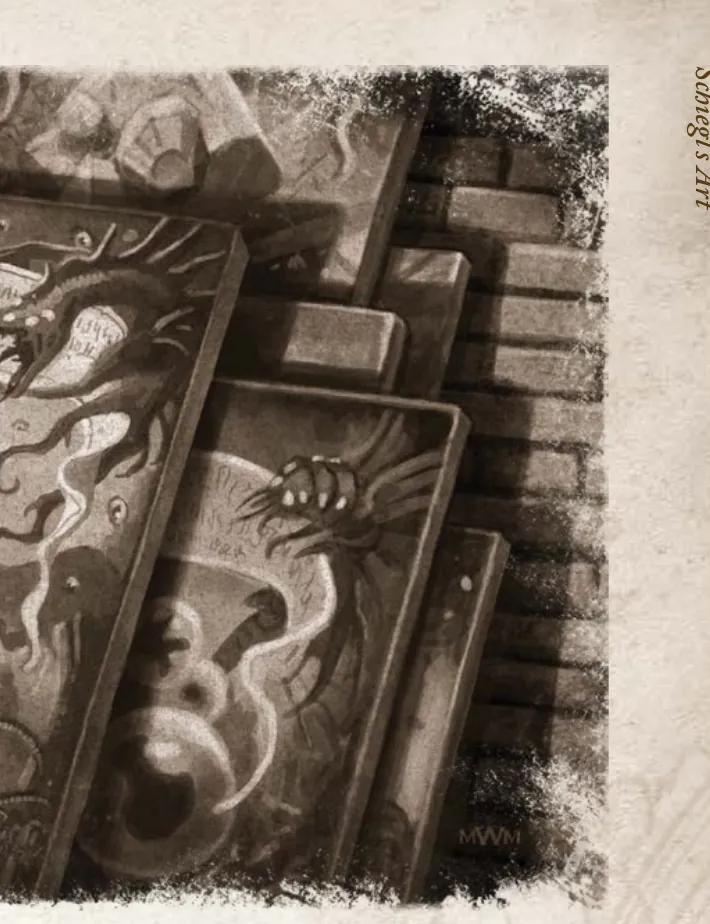

годы листьев, мусора и дождей сказались на мебели и отделке.

*Подпись: «Картины Шигля».*

**Уборные:** смесь сантехники викторианской эпохи и середины XX века; если спустить воду, обнаружится засор в трубах — унитазы до краёв наполняются мутной бурой водой. Ванны в пятнах от времени.

#### Второй этаж

**Коридор:** лестница из фойе ведёт наверх, в центральный коридор. В восточном конце сквозь полузакрытое ставнями окно пробивается немного света.

**Хранителю на заметку:** если смотреть вдоль коридора к восточному концу, позвольте проверку Внимания, чтобы заметить, что стена выступает на несколько сантиметров (это фальшивая стена, поставленная ещё в 1925 году, когда комнату Шигля заперли и закрыли). Если смотреть на северо-восточный угол снаружи отеля, ясно, что там есть «скрытая» комната (видны даже два тёмных зашторенных окна). Скорее всего, довольно рано в сценарии игрокам станет понятно, что здесь есть скрытая комната (тому, что колокольчик комнаты 7 всё звонит и звонит, это тоже поможет). Если они этого не заметят, пусть находку сделает рабочий-тлинкит (в подходящий момент) — он подходит к сыщикам и спрашивает, не снести ли стену, чтобы пробраться в комнату за ней. Этого должно хватить, чтобы пробудить их интерес.

**Номера 4–6 и 8–11:** все двери не заперты, кроме номеров 4, 6 и 10 (ключей нет, так что двери придётся либо выломать (проверка СИЛ), либо вскрыть (Взлом)). Как и номера первого этажа, в каждой комнате есть камин или печь, остов кровати, комод и стул. В некоторых комнатах есть платяной шкаф. Внимательные сыщики могут задуматься, куда делся номер 7.

**Уборные:** как и на первом этаже, уборные засорены.

**Номер 7:** спрятан за фальшивой деревянной стеной — её можно снести или проломить довольно быстро. За фальшивой стеной — настоящая стена и дверь с номером 7. На двери грубо нарисован белый крест (явно несколько десятилетий назад). Дверь заперта: чтобы попасть внутрь, нужна успешная проверка Взлома или трудная проверка СИЛ. По желанию Хранитель может сделать так, что дверь останется закрытой и неподвижной, будто её держит какая-то невидимая сила. Войти тогда можно, только прорубив дверь топором или проломив стену. (Возможно, когда это сделано, перед самым шагом сыщиков внутрь дверь сама собой таинственно распахивается.)
