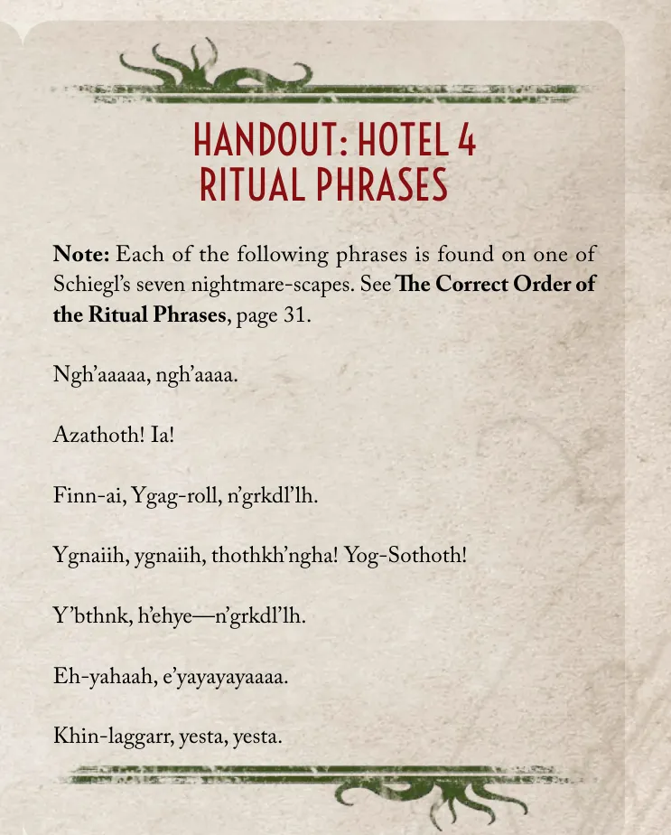

#### Подвал

Под отелем — большой подвал. Кирпичные и цементные стены и деревянные перегородки гниют. На стенах наклеены старые заплесневелые рекламные плакаты — видимо, чтобы добавить хоть немного красок и бодрости в довольно мрачную обстановку. Света нет. Когда сыщики спускаются, быстро становится ясно, что весь подвал затоплен на глубину 1 метра и дурно пахнет (вокруг плавают дохлые крысы, мыши и т. п.).

В северном конце — старый дровяной склад; большая часть дров теперь плавает в воде. Отгороженная уборная не работает (трубы забиты). В остальном в подвале — пустые стеллажи и всякий испорченный водой и заплесневелый хлам. Полный разгром.

Запечатанная ржавая металлическая бочка, спрятанная за разным хламом, несёт почти нечитаемую этикетку: внутри негашёная известь (см. врезку рядом) — опасный и потенциально смертельный порошок. Бочка простояла здесь много лет, и если сдвинуть её, пока подвал затоплен, есть шанс, что она протечёт, — известь вступит в реакцию с водой, и горючие материалы рядом (например, одежда) загорятся.

Все уборные в отеле засорены из-за засора в главных трубах, ведущих в выгребную яму рядом с подвалом и из неё. Как только к выгребной яме будет доступ (для этого придётся снести некоторые стены подвала), засоры можно прочистить.

На южной стене — большие рекламные плакаты шоколада «Херши» и Бориса Карлоффа в «Мумии»; оба отклеиваются от стены.

Тем, кто проводит в подвале больше 10 минут или около того, потребуйте проверку МОЩ: при успехе слышны слабые стоны и вой. Вой доносится отовсюду сразу. Услышав этот бесплотный звук, нужно пройти проверку Рассудка (потеря 1/1d4).

**Хранителю на заметку:** предполагается, что сыщики поручат одному-двум местным рабочим заняться подвалом: протянуть туда кабель и поставить свет, чтобы найти и устранить течь. Рабочие в итоге обнаружат, что вода сочится из южной стены, — в идеале примерно через час после начала сценария, — и начнут разбирать кирпичную стену, чтобы добраться до течи и заделать её. Когда рабочие начнут разбирать стену, в пролом можно посветить и различить за разбираемой стеной какую-то большую фреску, написанную на другой стене. Шигль написал фреску на изначальной стене подвала (см. «Фреска» ниже), которую позже скрыли за второй стеной (см. «Открытие врат ада», с. 27).

> **Раздатка «Материал: отель 4. Ритуальные фразы»**
>
> Нг’ааааа, нг’аааа.
>
> Азатот! Йа!
>
> Финн-ай, Игаг-ролл, н’гркдл’лх.
>
> Игнаиих, йгнайих, тотх’нгха! Йог-Сотот!
>
> И’бтнк, х’ехйе — н’гркдл’лх.
>
> Эх-йахаах, е’йайайайаааа.
>
> Хин-лаггарр, йеста, йеста.

*Прим. перев.: фразы — в написании официального русского издания раздаток; это заклинательные слова на языке Мифов, они не переводятся. В оригинале: «Ngh’aaaaa, ngh’aaaa. / Azathoth! Ia! / Finn-ai, Ygag-roll, n’grkdl’lh. / Ygnaiih, ygnaiih, thothkh’ngha! Yog-Sothoth! / Y’bthnk, h’ehye—n’grkdl’lh. / Eh-yahaah, e’yayayayaaaa. / Khin-laggarr, yesta, yesta.»*

Важно не дать сыщикам (и рабочим) слишком рано начать сносить фальшивую стену и найти фреску. Поначалу одному рабочему в подвале (который, например, тянет кабель и ставит свет) должно явиться видение Шигля — он в ужасе убегает и отказывается спускаться обратно. Спустя какое-то время рабочий успокаивается и возвращается (а может, не возвращается, и его сменяет другой). В подходящий момент сценария один из рабочих должен обнаружить течь и начать разбирать кирпичную стену в южном конце подвала. Если рядом в это время окажется сыщик, позвольте ему проверку Внимания, чтобы заметить фреску за стеной; иначе фреску находит рабочий и зовёт сыщиков посмотреть. Хранитель может усложнить дело: рабочих убивает один из мертвецов, вышедший из врат ада, — тогда, пока сыщики не догадаются проведать рабочих, они не найдут ни фреску, ни фальшивую стену; это также значит, что по меньшей мере один мертвец покидает подвал и начинает бродить по отелю. Встреча с первым мертвецом в другой части отеля поможет отвлечь внимание от подвала.

После того как фреска обнаружена, Хранитель решает, сколько времени займёт снос стены, — чтобы рассчитать события и нагнетать их к развязке. Когда фреска найдена, сыщики должны суметь начать складывать картину воедино и понять, что события по всему миру каким-то образом изображены на фреске. Учтите, что врата ада уже начинают открываться, позволяя мертвецам появляться в отеле, а также за его пределами, в окрестностях.

*Подпись на полях: «На следующем развороте: Фреска».*
