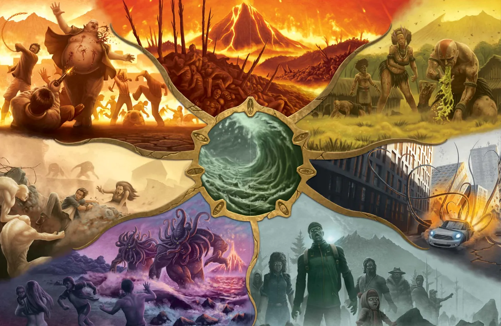

*Разворот на две страницы — фреска Шигля в подвале отеля. В центре — круг с гигантской океанской волной, по его краю — семь значков; вокруг — семь сцен катастроф: люди дерутся и бегут у огня; горы трупов под извергающимся вулканом; больные чумой люди, одного рвёт зелёной жижей; щупальца хватают людей и машину среди рушащихся домов; бледные сгорбленные фигуры набрасываются на людей среди развороченной земли; огромные существа с головами из щупалец выходят из кипящего моря у вулкана; толпа мертвецов с пустыми лицами смотрит на зрителя. Описание — в разделе «Фреска» (с. 24 оригинала).*
