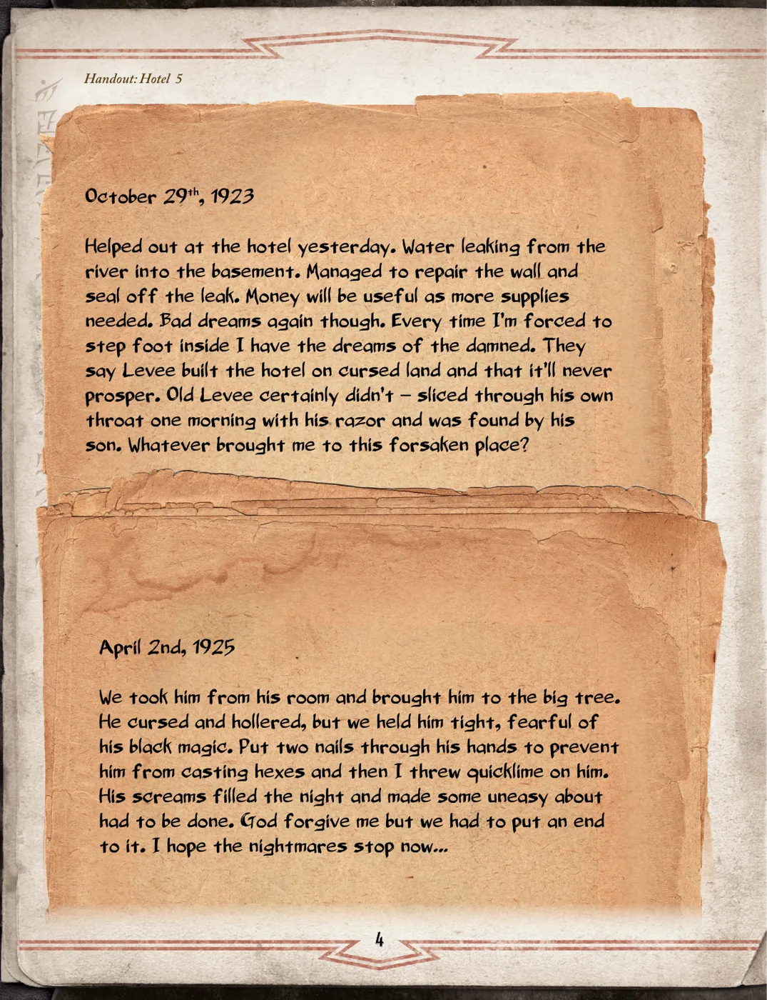

> **Раздатка «Материал: отель 5. Дневник поселенца»**
>
> *29 октября 1923*
>
> Вчера помогал в отеле. Вода из реки просочилась в подвал. Смогли починить стену и устранить протечку. Деньги не помешают, потому что нужны припасы. Но снова мучили кошмары. Каждый раз, когда приходится туда заходить, я потом вижу сны о проклятых душах. Говорят, Леви построил отель на дурной земле и тот никогда не будет процветать. Старому Леви это точно не принесло добра — как-то утром сынок нашёл его с перерезанным горлом. И что меня понесло в это Богом забытое место?
>
> *2 апреля 1925*
>
> Мы выволокли его из комнаты и потащили к большому дереву. Он ругался и орал, но мы держали его крепко, опасаясь злых чар. Забили два гвоздя в ладони, чтобы не дать ему творить заклинания, а потом я посыпал его негашёной известью. Его крики заполнили ночь, и некоторым стало не по себе от того, что мы должны были сделать. Да простит меня Бог, но этому нужно было положить конец. Надеюсь, теперь кошмары прекратятся...

*Прим. перев.: текст раздатки — официальный русский перевод. В оригинале сказано, что старый Леви сам перерезал себе горло бритвой однажды утром и его нашёл сын («sliced through his own throat one morning with his razor and was found by his son»); в русском издании самоубийство не упомянуто. Фраза «made some uneasy about had to be done» напечатана в оригинале с пропущенным словом; переведена по смыслу.*

Вот список возможных работ (см. «Внутри отеля», с. 16):

- устранить течь в подвале и откачать воду;
- протянуть кабели и свет по всему отелю, включая подвал;
- вынести мебель и хлам;
- разобраться с пыльными чехлами;
- обмерить окна, чтобы заказать новые стёкла;
- снять и заменить наружные и внутренние деревянные стены;
- вырубить заросли снаружи.

Устранить течь в подвале (из-за которой там скопилась вода) — первоочередное дело: на него стоит как можно скорее поставить пару местных рабочих, а остальные пусть займутся другими задачами, как сочтут нужным сыщики. Скорее всего, сыщики распределят рабочих по заданиям, а сами найдут время как следует осмотреть участок.

## Как вести сценарий

Секрет проведения «Адского отеля» — обеспечить игрокам ровный поток событий и улик, чтобы они сами сложили сведения в общую картину, — почти как Тёрстон, рассказчик в повести Лавкрафта «Зов Ктулху». Следите, чтобы улики к разгадке тайны и закрытию врат ада были разнесены и не выдавали всех ответов разом.

Сценарий должен разгоняться постепенно: малые события по ходу дела перерастают в крупные. Поскольку развязкой этого сценария может стать конец света, у Хранителя есть большая свобода разворачивать события в довольно бодром темпе. Если игроки слишком рано сосредоточились на определённых уликах или местах, подбросьте им события и встречи, которые отвлекут их или запутают дело.

Всё, что может произойти, перечислено в разделе «События» (с. 29) — Хранитель выбирает по обстановке и по тому, сколько времени осталось до конца игры. События стоит сочетать с пунктами из раздела «Срочные новости» (с. 30): Хранитель чередует эти «ресурсы» как сочтёт нужным.

Сценарий устроен как «песочница». Места (и события, привязанные к этим местам), а также небольшое число персонажей Хранителя создают «декорации» сценария, а события и новости — его «мясо».

Ловите тот момент игры, когда «до игроков дойдёт» и они поймут, что происходящее связано с миром за пределами отеля и что их действия имеют значение: они могут предотвратить гибель человечества. Это подтолкнёт игроков и их сыщиков к попытке закрыть врата. Если игра идёт, а игроки так и не
