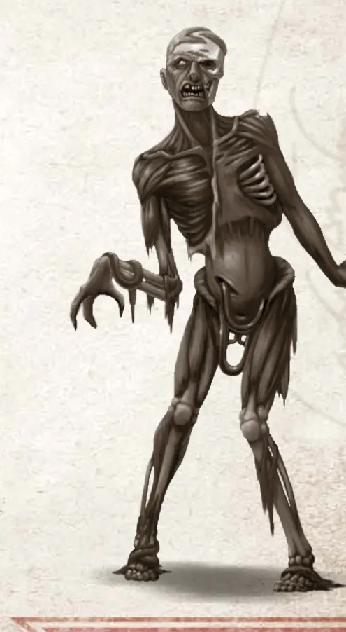

#### Преподобный Ребнеш, 63 года, проповедник геенны огненной

```stat
СИЛ 40    ВЫН 80    ТЕЛ 60    ЛВК 60    ИНТ 80
НАР 45    МОЩ 60    ОБР 80    Рассудок 60   ПЗ 14
БкУ: 0    Комплекция: 0   Скорость: 5   ПМ: 12

Бой
Ближний бой (драка)   30% (15/6), урон 1d3
Уклонение             30% (15/6)

Навыки: Обаяние 25%, Лазание 25%, Красноречие 50%, Первая помощь 70%, История 50%, Запугивание 60%, Язык (английский) 80%, Язык (лингит) 20%, Работа в библиотеке 40%, Слух 60%, Медицина 25%, Естествознание 40%, Ориентирование 30%, Оккультизм 45%, Пилотирование (лодка) 55%, Психология 65%, Внимание 65%, Скрытность 50%, Плавание 35%, Метание 30%.
```

#### Медведь Кермоде

```stat
СИЛ 110   ВЫН 65    ТЕЛ 110   ЛВК 70    ИНТ —
НАР —     МОЩ 50    ОБР —     Рассудок —    ПЗ 17
БкУ: +2d6   Комплекция: 3   Скорость: 12   ПМ: —

Бой
Атак за раунд: 2 (укус и/или удар лапой)
Ближний бой           40% (20/8), урон 1d6 + 2d6
Уклонение             35% (17/7)

Навыки: Лазание 40%, Слух 75%, Чутьё на добычу 70%.

Броня: 3 пункта (мех и хрящи).
Потеря Рассудка: нет.
```

#### Мертвецы из Миллиона избранных

Мертвецы — слуги Внешнего бога Ньярлатхотепа; они принадлежат к тем, кого называют «Миллионом избранных». Мертвецы бывают самые разные: это могут быть разлагающиеся останки старых старателей и поселенцев, а могут быть и пришельцы из любого уголка мира — адское измерение собирает многих в свои объятия. Точно так же любой сыщик, погибший по ходу сценария, пополнит их ряды.

Учтите: мертвецы — не зомби из массовой культуры (то есть они не едят мозги и не питаются живыми), но они нападут на живых и убьют их, если к ним приблизиться. Они нападут на тех, кто пытается закрыть врата. В остальное время они собираются у врат ада, будто ожидая зова, — кто знает, может быть, когда настанет срок, Ньярлатхотеп отдаст приказ, и они начнут действовать…

```stat
СИЛ 80    ВЫН 90    ТЕЛ 60    ЛВК 55    ИНТ 05
НАР —     МОЩ 10    ОБР —     Рассудок —    ПЗ 15
БкУ: +1d4   Комплекция: 1   Скорость: 5 (шаркающая походка)   ПМ: 2

Бой
Атак за раунд: 1 (укус, раздавливание, раздирание)
Учтите: когда мертвецы собираются толпой, у них может оказаться численное превосходство над сыщиками — см. «Численное превосходство», с. 108 «Книги правил» «Зова Ктулху».

Ближний бой           40% (20/8), урон 1d4
Раздавливание* (манёвр) 40% (20/8), жертва схвачена, в следующем раунде — раздавливание, урон 1d6
Уклонение             неприменимо

*Раздавливание: раз в раунд сыщик может попытаться вырваться или выскользнуть, пройдя проверку СИЛ или ЛВК против СИЛ мертвеца.

Броня: нет; серьёзная рана означает, что отвалилась конечность или голова (они продолжают «жить», пока их не уничтожат полностью).
Заклинания: нет.
Потеря Рассудка: 0/1d6 пунктов Рассудка при виде мертвецов.
```

*Прим. перев.: так в оригинале — у мертвецов БкУ +1d4, но урон указан без него (1d4 и 1d6); с учётом БкУ было бы 1d4 + 1d4 и 1d6 + 1d4.*



*Подпись: «Мертвецы».*
