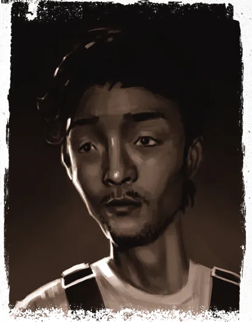

## Джаред Келли

**Возраст:** 33 года. **Профессия:** художник / владелец отеля



```stat
СИЛ 40    ВЫН 45    ТЕЛ 60    ЛВК 60    ИНТ 50
НАР 75    МОЩ 60    ОБР 60    Рассудок 60   ПЗ 10
БкУ: 0   Комплекция: 0   Скорость: 8   ПМ: 12   Удача: 70

Бой
Ближний бой (драка)   25% (12/5), урон 1d3
Уклонение             40% (20/8)

Навыки
Археология 20% (10/4)
Внимание 40% (20/8)
Искусство/ремесло (живопись) 60% (30/12)
История 30% (15/6)
Красноречие 50% (25/10)
Лазание 35% (17/7)
Метание 35% (17/7)
Механика 15% (7/3)
Оккультизм 30% (15/6)
Первая помощь 30% (15/6)
Прыжки 20% (10/4)
Психология 30% (15/6)
Работа в библиотеке 45% (22/9)
Скрытность 35% (17/7)
Слух 30% (15/6)
Средства 40% (20/8)
Стрельба (винтовка/дробовик) 25% (12/5)
Стрельба (пистолет) 35% (17/7)
Язык (английский) 60% (30/12)
Язык (немецкий) 15% (7/3)
```

**Бонус:** распределите 30 пунктов между любыми навыками на выбор игрока.

*Прим. перев.: в оригинале опечатка — «Brawl 25% (12/15)»; правильно 25% (12/5), как в русском издании. Здесь и далее листы готовых сыщиков — по официальному русскому изданию («Кошмары цифровой эпохи», готовые персонажи), навыки — в его порядке (по алфавиту).*

### Предыстория

Вы пошли учиться на художника, встретили милую девушку и вдвоём стали искать себе место в жизни. Да, всё пошло не совсем по плану. Вы продали всего несколько картин, но зато встретили много интересных людей, пока работали баристой.

И тут совершенно неожиданно вам пришло письмо из юридической фирмы, где говорилось, что дядя, которого вы никогда не знали, умер и оставил вам отель в Британской Колумбии. Вы собрали все свои сбережения и приняли решение вместе с Деброй начать новую жизнь и поселиться в отеле. Вы созвали группу друзей и все вместе отправились ремонтировать и готовить к открытию ваше новое предприятие.

- **Внешность:** среднего роста, скорее худой, с растрёпанными волосами.
- **Черты характера:** оптимистичный, доверчивый.
- **Убеждения и взгляды:** если жизнь даёт тебе шанс, нужно хвататься за него обеими руками.

### Ваши спутники

- **Дебра Келли:** жена. Последнее время у вас напряжённые отношения, так как она беспокоится из-за всей этой затеи с отелем.
- **Эльза Леманн:** сестра-близнец Дебры. Вы пытаетесь с ней ладить, но она вас явно недолюбливает. Однако она отличная повариха и станет хорошим добавлением к штату отеля.
- **Роб Харди:** отличный парень и плотник (что особенно полезно при ремонте отеля), который предложил свою помощь.
- **Дэн Харди:** брат Роба. Вы его почти не знаете, но, по словам Роба, он мастер на все руки, что будет очень кстати при ремонте.
- **Кристи Джонсон:** сводная сестра. Вы давно с ней не общались, но она ожидаемо пришла в восторг, когда услышала о вашем плане отремонтировать и открыть отель. Она приехала помочь.

*Прим. перев.: в оригинале Кристи — старая подруга Джареда («an old friend»), а не сводная сестра: «старая подруга, которая с головой окунулась в дело, когда вы рассказали о плане отремонтировать отель и вести его как бизнес; говорит, что приехала помочь». О Дэне в оригинале: «Дэн говорит, что он мастер на все руки».*
