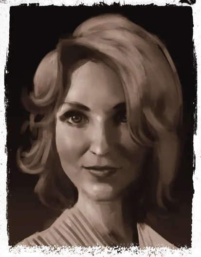

## Дебра Келли

**Возраст:** 33 года. **Профессия:** заместительница менеджера магазина / владелица отеля



```stat
СИЛ 60    ВЫН 40    ТЕЛ 50    ЛВК 70    ИНТ 70
НАР 65    МОЩ 55    ОБР 55    Рассудок 55   ПЗ 9
БкУ: 0   Комплекция: 0   Скорость: 9   ПМ: 11   Удача: 55

Бой
Ближний бой (драка)       35% (17/7), урон 1d3
Револьвер 32-го калибра   35% (17/7), урон 1d8
Уклонение                 35% (17/7)

Навыки
Бухгалтерское дело 35% (17/7)
Внимание 60% (30/12)
Вождение автомобиля 40% (20/8)
Лазание 20% (10/4)
Метание 40% (20/8)
Обаяние 40% (20/8)
Оккультизм 15% (7/3)
Ориентирование 25% (12/5)
Первая помощь 30% (15/6)
Прыжки 20% (10/4)
Психология 50% (25/10)
Скрытность 35% (17/7)
Слух 45% (22/9)
Средства 40% (20/8)
Стрельба (винтовка/дробовик) 25% (12/5)
Стрельба (пистолет) 35% (17/7)
Убеждение 55% (27/11)
Электрика 35% (17/7)
Юриспруденция 15% (7/3)
Язык (английский) 55% (27/11)
Язык (немецкий) 35% (17/7)
```

**Бонус:** распределите 30 пунктов между любыми навыками на выбор игрока.

*Прим. перев.: в оригинале профессия — «Store Manager / Hotel Proprietor» (менеджер магазина / владелица отеля); в предыстории — заместитель менеджера.*

### Предыстория

Всего пару недель назад вы вели обычную жизнь — работали заместительницей менеджера небольшого магазина одежды и думали о том, чтобы завести ребёнка со своим мужем Джаредом. И вот совершенно неожиданно Джаред унаследовал отель посреди Британской Колумбии. Как гром среди ясного неба.

Каким-то образом он смог убедить вас бросить работу и отремонтировать и открыть отель, чтобы начать новую жизнь. Вы сказали, что дадите этой затее год, и если всё пойдёт ужасно, Джаред продаст отель и вы вернётесь к цивилизации. Ваша сестра-близнец и друзья Джареда присоединились к вам, чтобы помочь со стройкой. Но действительно ли вы этого хотите?

- **Внешность:** среднего роста, с румяными щеками и светлыми волосами до плеч.
- **Черты характера:** прагматичная, любопытная, сомневающаяся.
- **Убеждения и взгляды:** этот отель может пожрать все ваши средства — когда же у вас появится шанс завести ребёнка?!

### Ваши спутники

- **Джаред Келли:** муж. Он в восторге от идеи с отелем — а вы начинаете уставать от его энтузиазма.
- **Эльза Леманн:** сестра-близнец. Вы её любите, но что бы вы ни делали, для неё всё недостаточно. Она профессиональная повариха, и вы надеетесь, что её отвлечёт работа на кухне отеля.
- **Роб Харди:** кажется славным парнем, да и Джаред говорит, что он превосходный плотник (что будет полезно при ремонте отеля). Но если это так, почему он всё бросил и поехал в Британскую Колумбию? Может быть, его дела шли не так уж хорошо.
- **Дэн Харди:** брат Роба. Вы его не знаете, но Роб говорит, что тот мастер на все руки и будет полезен при ремонте. В ходе перелёта он, кажется, пытался с вами флиртовать.
- **Кристи Джонсон:** какая-то старая знакомая Джареда (а может, бывшая девушка?). Она согласилась помочь наладить дела в отеле. Вы ей не доверяете.

*Прим. перев.: о Дэне в оригинале — «Дэн говорит, что он мастер на все руки».*
