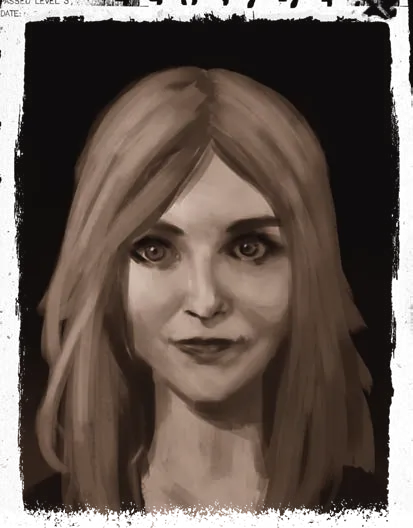

## Эльза Леманн

**Возраст:** 33 года. **Профессия:** повариха



```stat
СИЛ 50    ВЫН 65    ТЕЛ 50    ЛВК 60    ИНТ 60
НАР 60    МОЩ 55    ОБР 60    Рассудок 55   ПЗ 11
БкУ: 0   Комплекция: 0   Скорость: 8   ПМ: 11   Удача: 55

Бой
Ближний бой (драка)   45% (22/9), урон 1d3
Кухонный нож          45% (22/9), урон 1d4 + 2
Уклонение             30% (15/6)

Навыки
Бухгалтерское дело 20% (10/4)
Внимание 45% (22/9)
Естествознание 30% (15/6)
Запугивание 35% (17/7)
Искусство/ремесло (кулинария) 60% (30/12)
Лазание 20% (10/4)
Метание 30% (15/6)
Механика 25% (12/5)
Оккультизм 30% (15/6)
Ориентирование 30% (15/6)
Первая помощь 50% (25/10)
Прыжки 20% (10/4)
Психология 40% (20/8)
Работа в библиотеке 60% (30/12)
Скрытность 30% (15/6)
Слух 25% (12/5)
Средства 40% (20/8)
Стрельба (винтовка/дробовик) 25% (12/5)
Стрельба (пистолет) 35% (17/7)
Язык (английский) 60% (30/12)
Язык (немецкий) 30% (15/6)
```

**Бонус:** распределите 30 пунктов между любыми навыками на выбор игрока.

### Предыстория

«Семья — превыше всего», — так вам всегда говорила мама. У вас была хорошая работа в ресторане, когда совершенно внезапно ваша сестра-близнец заявила, что переезжает с мужем в Британскую Колумбию, чтобы вести отель. Что ж, они в вас нуждались, так что вы бросили работу и отправились с ними. Вы займётесь кухней отеля. В конце концов, вашей сестре необходима помощь — она и так уже испортила себе жизнь. Приглядывать за ней — ваш христианский долг.

- **Внешность:** среднего роста, бледная, с длинными светлыми волосами.
- **Черты характера:** опекающая, уверенная в себе и не отступающая от своего мнения.
- **Убеждения и взгляды:** вы знаете, как лучше, даже если другие люди сперва этого не понимают.

### Ваши спутники

- **Дебра Келли:** сестра-близнец. Вы хотите ей только добра. Если вам придётся перевернуть небо и землю, чтобы эта безумная идея с отелем увенчалась успехом, вы это сделаете!
- **Джаред Келли:** ленивый муженёк сестры. Он всегда складно говорит, но пока что ничего не сделал. По идее, он художник, но вы видели только то, как он подаёт кофе.
- **Роб Харди:** Джаред утверждает, что Роб — превосходный плотник (что полезно при ремонте отеля), но если он так хорош, почему всё бросил и поехал в Британскую Колумбию? Джаред спрашивал его рекомендации? Вы сильно в этом сомневаетесь.
- **Дэн Харди:** брат Роба. Роб говорит, что тот мастер на все руки, но пока в ходе всего путешествия он выглядел мрачно. Он оживлялся, только когда флиртовал с вашей сестрой. Вам стоит за ним следить.
- **Кристи Джонсон:** очевидно, одна из бывших девушек Джареда, и никому не понятно, зачем она с вами едет. Дебра считает, что та пытается снова сблизиться с Джаредом — но, может быть, это не так уж и плохо?
