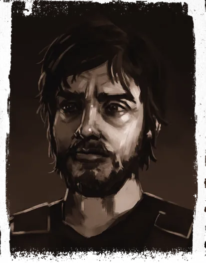

## Роб Харди

**Возраст:** 36 лет. **Профессия:** плотник



```stat
СИЛ 70    ВЫН 65    ТЕЛ 60    ЛВК 70    ИНТ 60
НАР 50    МОЩ 45    ОБР 60    Рассудок 45   ПЗ 12
БкУ: +1d4   Комплекция: 1   Скорость: 9   ПМ: 9   Удача: 50

Бой
Ближний бой (драка)   60% (30/12), урон 1d3 + БкУ
Уклонение             35% (17/7)

Навыки
Взлом 20% (10/4)
Внимание 30% (15/6)
Вождение автомобиля 30% (15/6)
Естествознание 30% (15/6)
Искусство/ремесло (плотничество) 60% (30/12)
Лазание 30% (15/6)
Метание 30% (15/6)
Механика 40% (20/8)
Обаяние 30% (15/6)
Ориентирование 40% (20/8)
Первая помощь 30% (15/6)
Прыжки 20% (10/4)
Психология 20% (10/4)
Скрытность 30% (15/6)
Слух 30% (15/6)
Средства 25% (12/5)
Стрельба (винтовка/дробовик) 35% (17/7)
Стрельба (пистолет) 20% (10/4)
Убеждение 30% (15/6)
Чтение следов 40% (20/8)
Электрика 30% (15/6)
Язык (английский) 60% (30/12)
```

**Бонус:** распределите 30 пунктов между любыми навыками на выбор игрока.

### Предыстория

Ваш друг Джаред недавно унаследовал старый отель в Британской Колумбии и планирует вместе с женой Деброй отремонтировать и открыть его. Последнее время дела у вас идут плохо, так что вы предложили свою помощь со стройкой. Остаётся надеяться, что денег хватит, чтобы снова встать (и поставить брата) на ноги.

Вы взяли с собой своего брата Дэна. Дэн постоянно попадал в неприятности и всю жизнь едва сводил концы с концами. Он только что вышел из тюрьмы, так что это станет для него хорошим шансом заняться честным трудом и поправить положение. Вы сказали Джареду, что Дэн — мастер на все руки. Это ложь, но вы уверены, что всё как-нибудь да обойдётся.

- **Внешность:** крепкий, небритый и обросший, в повседневной одежде.
- **Черты характера:** трудолюбивый и дружелюбный.
- **Убеждения и взгляды:** у каждого свой крест.

### Ваши спутники

- **Дэн Харди:** брат. Взяв его с собой в путешествие, вы сможете приглядывать за ним, чтобы он не вернулся к старым дурным привычкам. Вы надеетесь, что тюрьма послужила ему уроком, который он не захочет повторять. Кажется, он старается быть дружелюбным с Деброй и Эльзой.
- **Дебра Келли:** жена Джареда. Вы не уверены, что она целиком поддерживает план по восстановлению отеля. Между ней и её сестрой Эльзой чувствуется напряжение.
- **Джаред Келли:** кажется хорошим парнем. Он очень воодушевлён своим проектом, но несколько наивен — он ведь никогда и не видел отеля. Кто знает, на что тот будет похож, но вы не можете не уважать смелость Джареда.
- **Эльза Леманн:** сестра-близнец Дебры. Она повариха и должна заняться кухней отеля. Судя по тому, что вы пока видели, это упрямая и деловая женщина — неудивительно, что она, видимо, недолюбливает Джареда.
- **Кристи Джонсон:** одна из старых подруг Джареда. Кажется милой. Судя по всему, она инструктор по занятиям спортом на открытом воздухе. В том, как Дебра и Эльза смотрят на неё, когда она заговаривает с Джаредом, чувствуется неприязнь.
