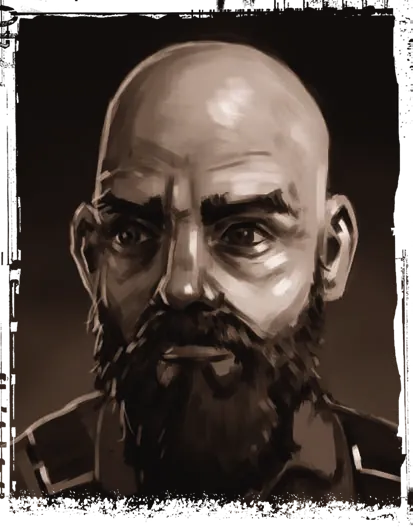

## Дэн Харди

**Возраст:** 34 года. **Профессия:** безработный (бывший заключённый)



```stat
СИЛ 65    ВЫН 60    ТЕЛ 60    ЛВК 80    ИНТ 55
НАР 55    МОЩ 60    ОБР 40    Рассудок 60   ПЗ 12
БкУ: +1d4   Комплекция: 1   Скорость: 9   ПМ: 12   Удача: 55

Бой
Ближний бой (драка)       40% (20/8), урон 1d3 + БкУ
Револьвер 32-го калибра   45% (22/9), урон 1d8
Уклонение                 40% (20/8)

Навыки
Взлом 50% (25/10)
Внимание 30% (15/6)
Естествознание 20% (10/4)
Запугивание 50% (25/10)
Искусство/ремесло (актёрская игра) 25% (12/5)
Лазание 20% (10/4)
Ловкость рук 40% (20/8)
Метание 30% (15/6)
Механика 40% (20/8)
Обаяние 40% (20/8)
Ориентирование 30% (15/6)
Первая помощь 30% (15/6)
Плавание 30% (15/6)
Прыжки 20% (10/4)
Психология 50% (25/10)
Скрытность 40% (20/8)
Слух 40% (20/8)
Средства 10% (5/2)
Стрельба (винтовка/дробовик) 35% (17/7)
Стрельба (пистолет) 45% (22/9)
Управление тяжёлыми машинами 10% (5/2)
Чтение следов 35% (17/7)
Электрика 20% (10/4)
Язык (английский) 40% (20/8)
```

**Бонус:** распределите 30 пунктов между любыми навыками на выбор игрока.

*Прим. перев.: в оригинале профессия — «Drifter (ex. Convict)» (бродяга, бывший заключённый).*

### Предыстория

Работа в офисе с девяти до семнадцати никогда вас не цепляла. Слишком много интересного пропускаешь — поэтому-то вам и было всегда трудно придерживаться чего-то одного. Уволившись из нескольких мест, вы сводили концы с концами мелкими преступлениями и сбытом краденого, за что и угодили в тюрьму. Сейчас вы вышли, и ваш братец Роб намерен наставить вас на путь истинный. Вот он и тащит вас в какую-то чёртову глухомань чинить какой-то там отель. Ради брата вы должны постараться. Хоть сейчас полиция к вам и не прикопается, временами всё же хочется вернуться к старой жизни, когда всё было проще.

*Прим. перев.: в оригинале Дэн сводил концы с концами торговлей наркотиками и мелкими преступлениями («drug dealing and petty crime»), а теперь «чист» от наркотиков («While you are clean of the drugs now»).*

- **Внешность:** крепко сбитый, с лохматой бородой и бритой головой, татуированный.
- **Черты характера:** беспринципный, хитрый, терпеливый.
- **Убеждения и взгляды:** кто-то не может переступить черту, но вы никогда не боялись её пересекать.

### Ваши спутники

- **Роб Харди:** брат. Постоянно твердит, как путешествие будет похоже на старые добрые деньки, когда вы ходили охотиться с отцом, — но вы всегда это ненавидели. Вы надеетесь, что среди дикой природы он расслабится и перестанет дышать вам в затылок.
- **Джаред Келли:** новый владелец отеля. Он болван. Блин, было бы так просто развести его на деньги, но, учитывая, что брат постоянно за вами следит, оно того не стоит. Возможно, шанс обогатиться за его счёт ещё представится.
- **Дебра Келли:** жена Джареда. Похоже, сильно злится на своего дурака-мужа. Её можно понять — судя по всему, ей пришлось бросить вполне неплохую работу из-за этой безумной затеи. Вы попытались сблизиться с ней и её сестрой, слегка выпив и пошутив во время перелёта. Лёгкий флирт может привести к выгодному дельцу — или хотя бы повеселит.
- **Эльза Леманн:** сестра-близнец Дебры и повариха. Хотя выглядит строгой, кажется, вы ей понравились. Она поделилась с вами своими соображениями насчёт этого безумного плана и своим мнением, что Джаред недостаточно хорош для её сестры. Вы улыбались и кивали.
- **Кристи Джонсон:** старая знакомая Джареда. Судя по всему, инструктор по занятиям спортом на открытом воздухе. Смешно смотреть, как сёстры носятся вокруг воображаемого романа Кристи и Джареда, — очевидно, что те общаются больше как брат и сестра, даже если не связаны кровно.

*Прим. перев.: в оригинале конец этого пункта другой: Дэну смешно, что сёстры боятся, будто Кристи нацелилась на Джареда, — ему совершенно ясно, что мужчины её не интересуют («men aren’t her scene»).*
