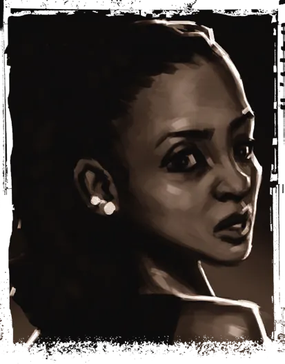

## Кристи Джонсон

**Возраст:** 32 года. **Профессия:** фитнес-тренер



```stat
СИЛ 80    ВЫН 80    ТЕЛ 50    ЛВК 70    ИНТ 55
НАР 65    МОЩ 50    ОБР 65    Рассудок 50   ПЗ 13
БкУ: +1d4   Комплекция: 1   Скорость: 9   ПМ: 10   Удача: 50

Бой
Ближний бой (драка)   70% (35/14), урон 1d3 + БкУ
Уклонение             40% (20/8)

Навыки
Внимание 25% (12/5)
Естествознание 40% (20/8)
Запугивание 30% (15/6)
Лазание 60% (30/12)
Метание 40% (20/8)
Обаяние 25% (12/5)
Оккультизм 20% (10/4)
Ориентирование 35% (17/7)
Первая помощь 70% (35/14)
Плавание 35% (17/7)
Прыжки 40% (20/8)
Психология 15% (7/3)
Работа в библиотеке 40% (20/8)
Скрытность 25% (12/5)
Слух 25% (12/5)
Средства 35% (17/7)
Стрельба (винтовка/дробовик) 25% (12/5)
Стрельба (пистолет) 20% (10/4)
Чтение следов 30% (15/6)
Язык (английский) 65% (32/13)
```

**Бонус:** распределите 30 пунктов между любыми навыками на выбор игрока.

### Предыстория

Перемена места — это то, что вам было нужно. Вы давно не виделись со своим сводным братом Джаредом, пока он не позвонил вам с новостью, что унаследовал отель в Британской Колумбии и планирует его отремонтировать. Он пригласил вас помочь ему с женой, сказав, что ему понадобятся знания тренера по занятиям на открытом воздухе. Учитывая ваш недавний разрыв с Самуэлем, вы непрочь начать новую жизнь. Помогать с открытием отеля наверняка будет очень интересно.

*Прим. перев.: в оригинале Джаред — старый друг Кристи («Your old friend Jared»), а не сводный брат, и недавний разрыв у неё — с Самантой («break up with Samantha»).*

- **Внешность:** стройная и атлетически сложенная, со вкусом, но просто одетая, волосы собраны в хвост.
- **Черты характера:** принимающая, независимая, осторожная.
- **Убеждения и взгляды:** лучший отдых — это перемены. Жизнь коротка — нужно действовать!

### Ваши спутники

- **Джаред Келли:** сводный брат, всегда полон оптимизма и готов веселиться. Вы давно не виделись, но он очень вас выручил, предложив эту возможность.
- **Дебра Келли:** жена Джареда. Ей явно не по душе вся затея с отелем, но её гнев почему-то обращён на вас. Кто знает почему — это ведь ваша первая встреча. Может быть, у них какой-то кризис в отношениях.
- **Эльза Леманн:** сестра-близнец Дебры и повариха. В целом приятный человек, ведь проделала весь этот путь, чтобы помочь сестре и Джареду с их новым делом. Только ведёт себя очень холодно, словно вы ей не нравитесь.
- **Роб Харди:** друг Джареда и плотник. Вроде нормальный, но всё время очень серьёзный. Ему не помешало бы развеяться.
- **Дэн Харди:** брат Роба. Славный парень, вы познакомились за время полёта. Вы не удивитесь, если он сидел в тюрьме. Как вам кажется, он постоянно меняет работу и любит лёгкую жизнь.

*Прим. перев.: в оригинале о Джареде — «вы старые друзья; он настоящая душка — всегда оптимист и готов повеселиться»; фразы «это ведь ваша первая встреча» о Дебре в оригинале нет — там сказано лишь, что её гнев на Кристи лишён смысла.*
