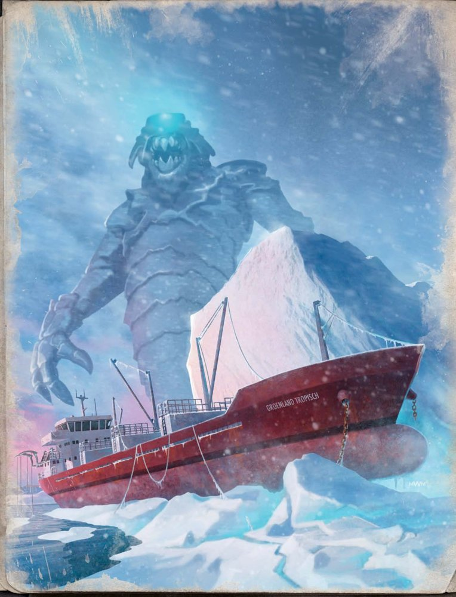

*Иллюстрация на всю страницу перед главой 2 «Заброшенный корабль»: красный рефрижератор «Гренланд Тропиш», застрявший на айсберге посреди метели; над ним нависает огромная белая тварь с зубастой пастью и светящимся глазом — скиапод.*
