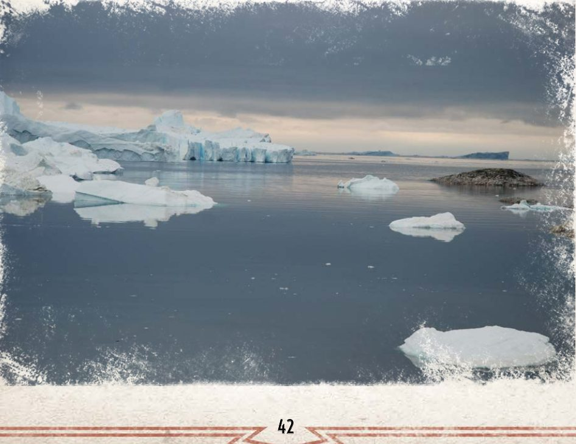

Сценарий, как он изложен, исходит из первого варианта: владелец роскошной яхты и его друзья идут через Северную Атлантику и натыкаются на «Гренланд Тропиш», застрявший на айсберге.

Для первого варианта даны шесть готовых сыщиков (см. с. 62); трое из них носят серебряные украшения — они отмечены (С):

- **Джейсон Керники,** биржевой маклер / владелец яхты
- **Айзек Клейн,** архитектор
- **Сирена,** исполнительница / певица (С)
- **Дженис Уайт,** знаменитая спортсменка (С)
- **Эрик Хастон,** владелец социальной сети
- **Эллен Грей,** известная актриса (С)

Если сыщиков создают заново, предлагаем такие профессии:

- **Вариант первый, владелец роскошной яхты и друзья:** бухгалтер, актёр (кинозвезда), архитектор, спортсмен, писатель, дизайнер, дилетант, врач, инженер, азартный игрок, юрист и служащий (успешный владелец бизнеса). Желательно, чтобы у одного персонажа игрока было инженерное образование, но это не обязательно.

    Кроме того, на борту должны быть один-два персонажа Хранителя — они могут играть роли капитана яхты и его помощника (оба наняты владельцем яхты) или быть другими друзьями владельца, если игроки захотят взять эти роли себе (для удобства даны два персонажа Хранителя, см. **Персонажи Хранителя и чудовище**, с. 60).

- **Вариант второй, команда спасателей:** водолаз, инженер, механик, моряк, солдат / морской пехотинец (в отставке). И здесь пусть один-два персонажа Хранителя будут членами команды.

**Важно:** на протяжении всего сценария Хранитель должен следить, у кого из сыщиков кожа касается серебра. Чудовище в этом сценарии обычно невидимо, и увидеть его истинный облик могут только те, чья плоть касается серебра (см. **Скиапод**, с. 60). Постарайтесь, чтобы игроки не узнали об этом, пока не догадаются сами. Ненавязчивыми вопросами при создании персонажей или в начальной сцене выясните, кто носит украшения, или просто прикиньте, у кого из персонажей может быть кольцо, цепочка или серьги из стерлингового серебра. Если сомневаетесь, носит ли персонаж серебро, решите это проверкой **Удачи** — и не забудьте записать успехи на потом, когда персонажи окажутся лицом к лицу с чудовищем.

