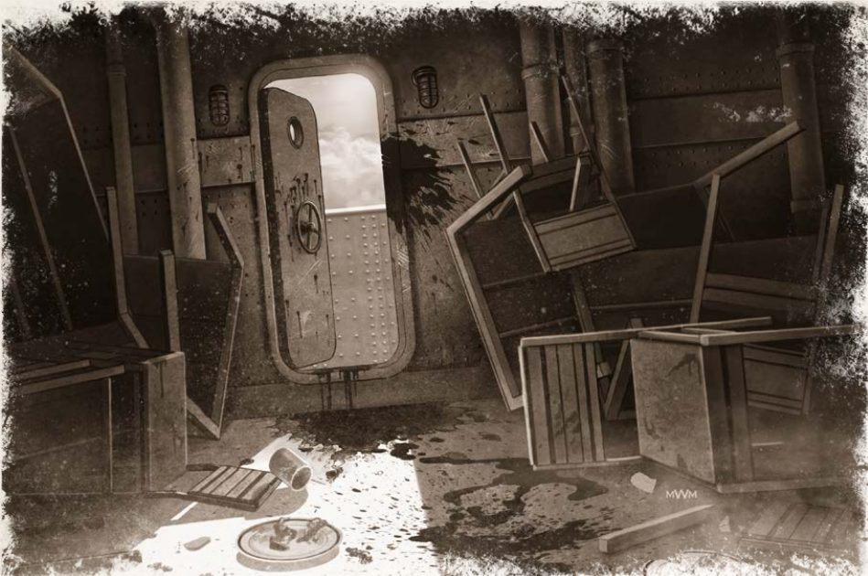

В сейфе — (запертая) денежная шкатулка с 7000 датских крон (1000 долларов), а также судовые документы и прочие страховые бумаги.

Изучив книги по морскому праву, можно найти сведения о праве на спасание. См. **Право на спасание**, с. 45.

**Кабинет старшего механика (4):** дверь заперта (чтобы открыть, нужна проверка **Взлома** или трудная проверка **СИЛ**; обычная, если использовать рычаг). Внутри — металлические картотечные шкафы, стол и вращающееся кресло. Комната выглядит нетронутой, только два ящика шкафа выдвинуты, и из них наполовину торчат разные бумаги (будто кто-то что-то искал). В одном ящике — документы по палубным кранам, в другом — бланки проверок безопасности, описи и счета за баллоны с CO2.

**Столовая офицеров (1):** ряды стульев и столов. На белых тарелках стынут недоеденные обеды, вокруг разбросаны столовые приборы.

**Камбуз (2):** на большом камбузе — множество кастрюль, сковород и прочей кухонной утвари. В больших кастрюлях на холодных плитах застыла еда. Котёл с рагу опрокинут, и его содержимое замёрзло лужей на полу. Здесь можно найти всевозможные кухонные ножи и инструменты.

**Столовая экипажа (3):** зеркальное отражение столовой офицеров, только несколько столов поставлены на бок, будто из них строили баррикаду. Похоже, это не помогло: столы погнуты, перекручены и залиты кровью. По полу тянутся замёрзшие кровавые следы.

**Возможные находки:**

- Кровавые следы и брызги крови на полу и стенах.
- Сигнальный пистолет (ракетница), разряженный.
- Большой кухонный нож; лезвие покрыто коркой белого вещества, почти как молоко.
- Бутылки и тряпки для коктейлей Молотова.

### Уровень 2 надстройки: каюты экипажа

Тёмные лестницы ведут на второй уровень и дальше, на верхние уровни. Коридоры безмолвны; они выходят к разным каютам экипажа, а также к кают-компании экипажа с баром, прачечной (16) и лазарету (17). Все внутренние двери не заперты, большинство приоткрыты и лениво качаются; время от времени какая-нибудь дверь захлопывается, и по судну разносится металлическое эхо.
