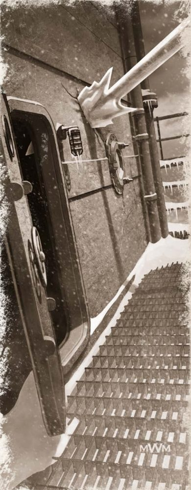

**Хранителю на заметку:** рулевую рубку разгромил скиапод. А ещё до того Торольф Лёфгрен увидел чудовище и обезумел; в приступе безумия он схватил настенный топор и набросился на радио, нанеся значительный и непоправимый ущерб, пока экипаж не скрутил его.

Те, у кого есть **Пилотирование (лодка)**, **Наука (инженерия)**, **Управление тяжёлыми машинами** (без проверки) или кто пройдёт трудную проверку **Механики**, могут оценить, что, хотя пользоваться приборами управления судном нельзя, его можно отбуксировать в порт, если только вытащить его из айсберга. Сыщики с этими навыками понимают и то, что свет на судне лучше всего включать из машинного отделения под палубой.

**Возможные находки:**

- **Внимание:** следы крови среди обломков в радиорубке.
- **Внимание:** никаких следов крови среди обломков в рулевой рубке.
- Пустые крепления пожарного топора на стене наружной верхней палубы.

### Грузовые трюмы

Грузовых трюмов три; в каждый можно попасть с главной палубы и снизу, из-под палубы. Каждый трюм изолирован от других. Под палубой вдоль коридоров тянутся разные трубы (по ним идёт хладагент) к трюмам и батареям компрессоров. У каждого трюма свой пульт управления охлаждением, но системы сейчас не работают. Трюмы заполнены не полностью: какие-то пусты, какие-то заполнены лишь частично. Повсюду разбросаны упаковочные коробки, клети, брезент, цепи, канаты, поддоны и тому подобное. Здесь можно найти небольшой вилочный погрузчик, бульдозер и лебёдки: чтобы воспользоваться машинами, их нужно заправить (надо найти дизельное топливо) и пройти успешную проверку **Управления тяжёлыми машинами** либо трудную проверку **Механики** или **Вождения автомобиля**.

Здесь темно, холодно и неуютно. Можно поскользнуться на льду или на инструменте, валяющемся на полу (по ситуации назначьте проверку **ЛВК**, чтобы не споткнуться и не упасть); разумеется, у кого есть фонарь, тот может избежать таких опасностей.

- **Трюм 1:** мясные продукты и останки экипажа.
- **Трюм 2:** овощи и фрукты.
- **Трюм 3:** молочные продукты.

**Хранителю на заметку:** когда сыщики поднимаются на борт «Гренланд Тропиш», скиапод отдыхает под своей гигантской ногой в трюме 1, под брезентом. Просто упомяните, что, кроме поддонов с мясом и висящих говяжьих туш, здесь есть пустые ящики, часть которых накрыта брезентом. Помните…

