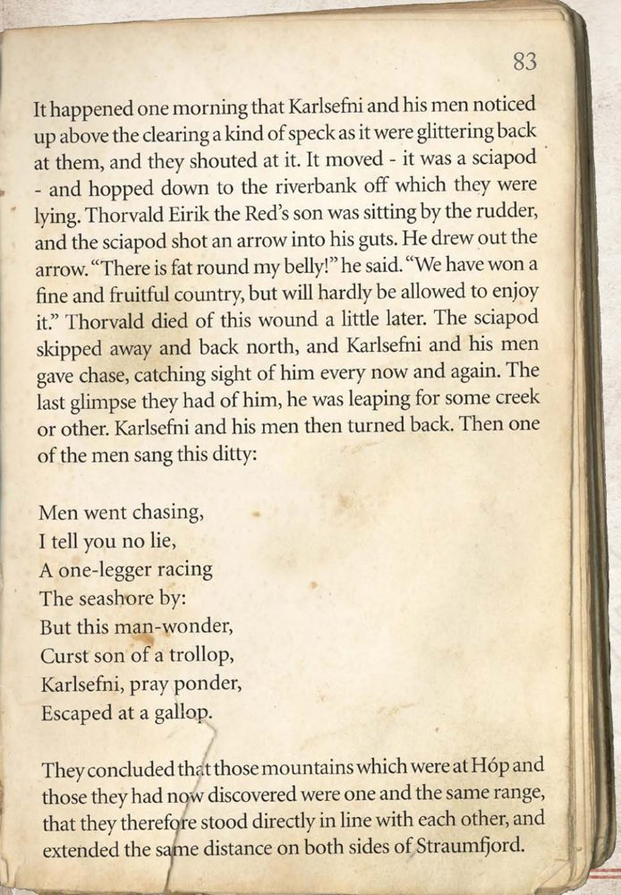

> **Раздатка «Материал: заброшенный корабль 3»: страницы «Саги об Эйрике Рыжем» — правая страница (с. 83)**
>
> Однажды утром Карлсефни и его люди увидели на дальней стороне прогалины какое-то пятнышко, которое поблёскивало, и они закричали на него. Пятнышко зашевелилось, и это оказался одноногий человек, который бросился скачками туда, где стоял их корабль. Торвальд, сын Эйрика Рыжего, сидел у руля. Одноножка попал ему стрелой в низ живота. Торвальд выдернул стрелу и сказал:
>
> — Богатую страну мы нашли. Жиром обросли мои кишки.
>
> Вскоре после этого Торвальд умер от раны. Одноножка бросился убегать на север. Карлсефни и его люди погнались за ним и по временам видели, как он убегал от них. Наконец он скрылся от них в какой-то бухте, и они повернули назад. Тогда один из них произнёс такой стишок:
>
> *Воины гнались —* 
> *Говорю я правду —* 
> *За одноножкой* 
> *Вниз к берегу.* 
> *Чудной человек* 
> *Мчался как вихрь* 
> *По бездорожью.* 
> *Слушай, Карлсефни!*
>
> Затем они поплыли снова на север и считали, что они в Стране Одноножек. Но они решили больше не подвергать опасности своих людей. Они полагали, что горы у Озерка и те, которые они теперь видели, это одни и те же горы и что обе местности одинаково отстоят от Оточного Фьорда.

*Прим. перев.: текст правой страницы — официальный русский перевод из «Кошмаров цифровой эпохи: материалов для игроков» («Материал: заброшенный корабль 3»); он сделан с древнеисландского текста, поэтому в нём «одноногий человек», «одноножка», «Озерко» и «Оточный Фьорд». В английском тексте раздатки существо прямо названо скиаподом (sciapod), раненый Торвальд добавляет: «Мы завоевали прекрасную и плодородную страну, да вряд ли нам дадут ею насладиться», скиапод в последний раз виден прыгающим к какому-то ручью, а места названы Хоп и Страумфьорд.*
