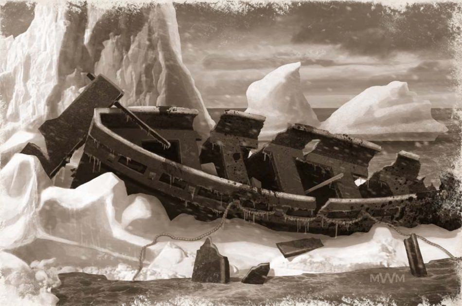

…помощь тех, кто рядом), иначе он может утонуть (применяйте правила утопления, с. 124 *Call of Cthulhu Rulebook*). Учтите, что трудные проверки **ВЫН** нужны, чтобы не утонуть в ледяной воде Северной Атлантики.

Если сыщик находится на айсберге без достаточно тёплой одежды, через 30–60 минут наступает переохлаждение: назначьте проверку **ВЫН**; при провале сыщик страдает от переохлаждения. Переохлаждение вызывает спутанность мыслей (штрафная кость ко всем проверкам навыков) и наносит 1d4 урона. Если пребывание на холоде продолжается, назначайте проверку **ВЫН** каждый час, пока сыщика не спасут и не согреют или пока он не умрёт. За каждую проваленную проверку ВЫН сыщик получает ещё 1d4 урона. После каждой проваленной проверки ВЫН сложность следующей повышается (то есть после одного провала следующая проверка будет трудной, а дальше все проверки ВЫН — чрезвычайными). Когда сыщика как следует согреют и он отдохнёт, он восстанавливает 1d3 пункта здоровья, а остальное — с обычной скоростью.

*Прим. перев.: в оригинале первое упоминание — «hyperthermia» (перегрев); по смыслу (холод, лёд) и по следующей фразе — переохлаждение (hypothermia), так и переведено.*

Единственное, что интересно на айсберге, — остатки пропавшей спасательной шлюпки «Гренланд Тропиш». Когда двое моряков пытались бежать, скиапод прыгнул в воду и притащил шлюпку обратно к айсбергу, где убил людей и выбросил лодку на лёд. Обломки шлюпки разбиты, изорваны и покрыты замёрзшей кровью.

## Борьба со скиаподом

Изобретательные игроки, надеемся, сумеют придумать подходящий план, как справиться с невидимым чудовищем. Ниже — несколько возможностей; старайтесь подталкивать игроков использовать то, что их окружает, а не просто думать, как схватиться со скиаподом в лоб. Остроумные замыслы стоит вознаграждать.

Скорее всего, в большинстве планов будет несколько «подвижных частей», и каждому сыщику придётся играть свою роль — заманивать, ловить или ранить чудовище. Кому-то из сыщиков, возможно, придётся быть приманкой (может быть, с проверкой **Рассудка**, чтобы сохранить хладнокровие), кому-то — позаботиться, чтобы дверь открылась или закрылась в нужный момент и направила скиапода в нужную сторону (возможно, нужна проверка **Механики** или **ЛВК**), а потом ещё нужно пустить в ход краны или бульдозер, чтобы ранить существо или сбросить его с судна (для этого надо уметь водить машину или управлять техникой). Продумайте план игроков и договоритесь, какие проверки навыков нужны для разных его частей, и не требуйте повторять проверки (это только снижает шансы на успех): уместна одна проверка на действие (*например*, если сыщик должен заманить чудовище, убегая от него, назначьте лишь одну проверку ЛВК и разрешите повторные проверки). Когда план согласован…
