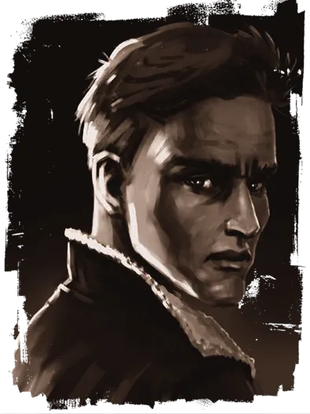

## Готовые сыщики

### Джейсон Керники



```stat
Возраст: 29   Профессия: биржевой маклер / владелец яхты

СИЛ 50    ВЫН 70    ТЕЛ 50    ЛВК 50    ИНТ 80
НАР 40    МОЩ 60    ОБР 60    Рассудок 60   ПЗ 12
БкУ: 0   Комплекция: 0   Скорость: 8   ПМ: 12   Удача: 50

Бой
Ближний бой (драка)   55% (27/11), урон 1d3
Уклонение             25% (12/5)

Навыки
Бухгалтерское дело 50% (25/10)
Внимание 40% (20/8)
Запугивание 60% (30/12)
Лазание 40% (20/8)
Метание 20% (10/4)
Механика 20% (10/4)
Первая помощь 30% (15/6)
Пилотирование (лодка) 40% (20/8)
Плавание 40% (20/8)
Прыжки 20% (10/4)
Психология 50% (25/10)
Работа в библиотеке 60% (30/12)
Скрытность 40% (20/8)
Слух 40% (20/8)
Средства 60% (30/12)
Стрельба (винтовка/дробовик) 45% (22/9)
Стрельба (пистолет) 40% (20/8)
Электрика 10% (5/2)
Юриспруденция 40% (20/8)
Язык (английский) 60% (30/12)

Бонус: распределите 30 пунктов между любыми навыками на выбор игрока.
```

*Прим. перев.: в оригинале — «Credit Rating 60% (22/9)»: доли подходят к 45%, и в русском издании напечатано «Средства 45% (22/9)». Здесь, как в базе, — процент оригинала с исправленными долями, 60% (30/12); какое значение верно, решает Хранитель.*

**Биография**

Вы владелец роскошной яхты под названием «Далила», отправившийся в последнее путешествие по Атлантическому океану со своими друзьями. К сожалению, экономическая обстановка оказалась неблагоприятной для ваших инвестиций, так что вы вынужденно продали свою яхту покупателю из Англии. Вы постарались выжать всё из этого последнего плавания, пригласив своих друзей присоединиться к вам.

- **Описание:** худой, с острыми чертами лица, светлыми волосами и лукавым взглядом.
- **Черты характера:** жадный, самовлюблённый.
- **Идеалы и принципы:** неудачнику не стать победителем. Не будь неудачником. Умей себя защищать.
- **Ценное имущество:** золотые часы «Ролекс».

**Ваши друзья:**

- **Айзек Клейн:** успешный архитектор. Похоже, он вас простил, несмотря на все убытки из-за инвестиций, которые вы ему посоветовали.
- **Сирена:** певица и авторша песен в зените славы. А ещё настоящая тусовщица.
- **Дженис Уайт:** спортсменка, которая упустила золото на последней Олимпиаде. Она теряет спонсоров и надеется, что вы сможете познакомить её с новыми инвесторами.
- **Эрик Хастон:** владелец социальной сети. Вы помогли ему с рядом инвестиций несколько лет назад — да, они не особо окупились, но и катастрофы не произошло. Он легко мог бы помочь вам с финансовыми проблемами, но предпочитает лишний раз на других не тратиться. Временами чудак.
- **Эллен Грей:** актриса и звезда того популярного телесериала. Она всегда строго держится перед публикой, но вы знаете, насколько безумной гедонисткой она становится, когда рядом нет камер.
