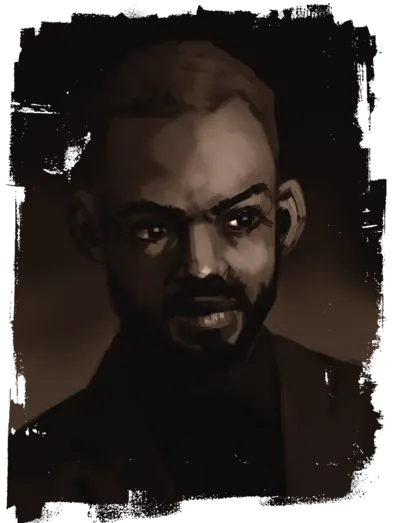

### Айзек Клейн



```stat
Возраст: 32   Профессия: архитектор

СИЛ 40    ВЫН 60    ТЕЛ 50    ЛВК 50    ИНТ 70
НАР 60    МОЩ 60    ОБР 80    Рассудок 60   ПЗ 11
БкУ: 0   Комплекция: 0   Скорость: 8   ПМ: 12   Удача: 50

Бой
Ближний бой (драка)   35% (17/7), урон 1d3
Уклонение             35% (17/7)

Навыки
Взлом 20% (10/4)
Внимание 50% (25/10)
Естествознание 40% (20/8)
Искусство/ремесло (архитектура) 60% (30/12)
История 40% (20/8)
Лазание 20% (10/4)
Ловкость рук 20% (10/4)
Метание 40% (20/8)
Наука (инженерия) 70% (35/14)
Первая помощь 30% (15/6)
Плавание 20% (10/4)
Прыжки 30% (15/6)
Психология 20% (10/4)
Работа в библиотеке 20% (10/4)
Скрытность 40% (20/8)
Слух 25% (12/5)
Средства 55% (27/11)
Стрельба (винтовка/дробовик) 25% (12/5)
Стрельба (пистолет) 20% (10/4)
Убеждение 40% (20/8)
Управление тяжёлыми машинами 40% (20/8)
Электрика 60% (30/12)
Юриспруденция 50% (25/10)
Язык (английский) 80% (40/16)

Бонус: распределите 30 пунктов между любыми навыками на выбор игрока.
```

*Прим. перев.: в оригинале — «Science (Engineering) 70% (30/12)»: доли не подходят к 70%; здесь, как в русском издании, — 70% (35/14).*

**Биография**

Вы друг или знакомый Джейсона Керники, биржевого маклера, который по случаю давал вам советы насчёт инвестиций. Упадок экономики сильно по нему ударил, так что он вынужденно продал свою роскошную яхту. Никогда не унывающий, он пригласил вас (и ещё несколько состоятельных друзей) в последнее плавание, прежде чем он передаст ключи от «Далилы» новому владельцу в Англии.

- **Описание:** сдержанный костюм, каштановые волосы, ухоженная щетина.
- **Черты характера:** осторожный, сохраняющий хладнокровие в случае опасности.
- **Идеалы и принципы:** оцени ситуацию, прежде чем бросаться вперёд.

**Ваши друзья:**

- **Джейсон Керники:** вы так и не простили его за убытки из-за инвестиций, которые он вам посоветовал. Вы с нетерпением ждёте момента, когда ему придётся отдать яхту (свою гордость и отраду). Что посеешь, то и пожнёшь — вам будет приятно наблюдать за его страданиями.
- **Сирена:** певица и авторша песен в зените славы. А ещё настоящая тусовщица.
- **Дженис Уайт:** спортсменка, которая упустила золото на последней Олимпиаде. Она постоянно пристаёт к вам с просьбами познакомить её с вашими партнёрами — ей нужны новые спонсоры.
- **Эрик Хастон:** владелец социальной сети. Он какой-то странный. Вы не очень понимаете, зачем он здесь, так как он особенно ни с кем не общается и ничего не делает. Вы надеетесь уговорить его на заказ нового здания для своей фирмы, но пока он, видимо, набивает себе цену.
- **Эллен Грей:** актриса и звезда того нового телесериала. Это совершенно безумная и неуправляемая дамочка! Боже, папарацци убили бы за её фотографии с яхты.
