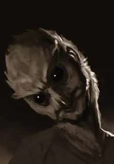

- **Внешность:** выглядит на десять лет моложе; стальные голубые глаза и густые светлые волосы.
- **Мутировавший облик:** получеловек-полубульдог; из неестественно широкого рта постоянно течёт слюна, руки и ноги короткие, тело покрыто шерстью.
- **Черты:** строгий, говорит прямо.
- **Зацепки для отыгрыша:** начальник Гаса Филипса. Старается отвлечь внимание от «ЗиМедБио».

### Энтони Каллисон, *48 лет, редактор*

Каллисон — редактор местной газеты «Морнинг ньюс», в которой работает готовый сыщик Эллиот Клосон. Каллисон никогда не скрывал, что у него ВИЧ, и, когда болезнь перешла в развёрнутый СПИД, заинтересовался расследованием Клосона о «ЗиМедБио». Каллисон решил, что терять ему нечего, и записался на экспериментальные испытания препарата.

Когда «ЗиМедБио» его приняла, Каллисон сказал Клосону, что воспользуется случаем и порыщет по зданию. Через три недели Каллисон вернулся в редакцию и заявил, что болезнь у него в полной ремиссии. Изумлённому Клосону велели бросить расследование: Каллисон-де может подтвердить, что фирма и её испытания совершенно законны, — он сам видел доказательства, и никакой истории тут нет.

Каллисона, как и Теда Доусона, с помощью гипноза приучили защищать «ЗиМедБио» и её владельцев. Если «ЗиМедБио» понадобится, Каллисона можно вызвать, чтобы пресечь любые журналистские расследования. Если положение обострится, Каллисон может объединиться с Доусоном и попытаться раз и навсегда заставить замолчать своих строптивых подчинённых (Клосона и Филипса).

**Примечание:** внушение Каллисона хорошо скрыто и раскроется, только если он окажется в крайнем положении — например, получит серьёзную рану или потеряет много Рассудка: тогда внушение берёт верх, и он отбрасывает всякое притворство, по сути превращаясь в автомат, нацеленный лишь на защиту «ЗиМедБио» любыми необходимыми средствами. На усмотрение Хранителя трудного успеха проверки **Психоанализа** или **Гипноза** может хватить, чтобы снять внушение с Каллисона.

*Прим. перев.: в оригинале здесь «Master's conditioning» («внушение Хозяина») — остаток шаблона; по смыслу — внушение Каллисона.*

- **Внешность:** выглядит здоровым (на вид чуть за сорок), непослушные каштановые волосы и борода, широкие пластиковые очки «под черепаху».
- **Мутировавший облик:** получеловек-полусова; неестественно большие глаза, зачаточный клюв, перья; может поворачивать голову почти на 360 градусов.
- **Черты:** обычно живой и лёгкий в общении; когда речь заходит о «ЗиМедБио», становится серьёзным и сдержанным.
- **Зацепки для отыгрыша:** начальник Эллиота Клосона. Старается отвлечь внимание от «ЗиМедБио».

> **Тёмная молодь, дитя Шуб-Ниггурат**
>
> Братья Анак удостоились прибытия тёмной молоди, которая существует, чтобы помогать призывать Шуб-Ниггурат. Тёмная молодь вросла в главные серверные стойки в подвале восточного крыла — нечестивое соединение плоти Мифов и техники. Используя объединённые системы «ЗиМедБио», тёмная молодь может призывать в здание часть Шуб-Ниггурат, чтобы собирать её мерзкое молоко. Тёмная молодь происходит от Матери и сама размножаться не может. Здесь она — нечто вроде повитухи, способствующей развитию и размножению амебозоев.
>
> Хотя тёмная молодь соединена с серверами проводами и щупальцами, она может немного передвигаться по подвалу. Если на неё напасть, она может вырваться из соединений, опрокидывая аппаратуру и разрывая серверы, чтобы добраться до надоедливых сыщиков.
>
> Тёмная молодь подключена к системам здания и через камеры видеонаблюдения может следить за продвижением сыщиков, проникших в здание. Впервые сыщики сталкиваются с существом через интерком — разумеется, они не будут знать, что с ними говорит тёмная молодь. Подробнее см. «Холодные слова», с. 90.
>
> - **Внешность:** огромная извивающаяся масса чёрных канатоподобных щупалец на склизком древовидном стволе, полном разверстых пастей; из него растут крепкие ноги, оканчивающиеся зловещими копытами. Щупальца переплетаются с электрическими и служебными кабелями, ведущими к серверам здания, — кошмар в духе Гигера.
