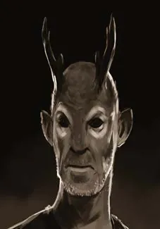
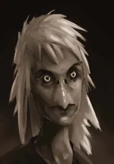

Он может сказать лишь, что однажды ему показали «Доильню» и что он больше никогда не хочет туда возвращаться. Конати — культист Шуб-Ниггурат, обращённый в культ братьями Анак. В повиновении его держит страх, а не преданность.

В третьей части сценария сыщики могут встретить Конати в облике меньшего сатира в исследовательском крыле «ЗиМедБио» (см. «Хранилище третичного биоцита», с. 94).

- **Внешность:** жилистый и подтянутый, светлые волосы и сверкающие зубы.
- **Мутировавший облик:** получеловек-полуолень; руки и ноги оканчиваются копытами, изо лба растут рога.
- **Черты:** помешан на фитнесе, жаден и намеренно не желает знать, что творится в «ЗиМедБио».
- **Зацепки для отыгрыша:** бывший начальник Марины Колги. Может устроить сыщику проверку для участия в испытании «Зилактиса». Скорее всего, сыщики встретят его в облике меньшего сатира, когда проникнут в «ЗиМедБио».

### Бланш Юрка, *44 года, личная помощница Джима Конати*

Бланш — личная помощница Джима Конати: она ограждает его стол от нежелательных посетителей. Держится она всегда вежливо и профессионально. Бланш — преданная культистка Шуб-Ниггурат, обращённая в культ братьями Анак. Ей поручено следить, чтобы Джим Конати оставался послушен культу. Скорее всего, сыщики встретят Бланш, когда она уже мутирует в гибрид человека и птицы. Подробнее см. «Сатиры», с. 77.

- **Внешность:** полноватая, каштановые волосы до плеч и тёмно-зелёные глаза.
- **Мутировавший облик:** полуженщина-полуптица; быстро двигается, зачаточный клюв, волосы превратились в белые перья.
- **Черты:** очень организованная и точная, бдительно присматривает за Джимом Конати, осторожна.
- **Зацепки для отыгрыша:** охраняет вход в кабинет Джима Конати.

### Другие сотрудники «ЗиМедБио»

Прочие сотрудники «ЗиМедБио» почти не играют роли в сценарии. Большинство из них сыщики так и не встретят, если только не попробуют посетить компанию днём (см. «Визит в „ЗиМедБио“ в рабочее время», с. 84). Ниже перечислены заметные сотрудники.

- **Брэд Местлер,** руководитель бухгалтерии — в третьей части встречается в облике мутировавшего существа, помеси летучей мыши и лягушки.
- **Беатрис Эйприл,** лаборантка — в третьей части встречается в облике мутировавшей девушки с черепом вместо головы.
- **Эсме Ричардс,** отдел работы с клиентами — сыщики могут встретить её, если кто-то попробует попасть в испытание «Зилактиса».
- **Тиана Фримен,** руководитель отдела кадров.
- **ИТ-отдел** (Алан Госс, Санджит Пингл, Аниш Рама, Джесс Уайт).
- **Итан Брок,** личный помощник Уэсли Райса.
- **Уэсли Райс,** начальник охраны.
- **Энн Джонс,** личная помощница Льюиса Питтса.
- **Льюис Питтс,** руководитель отдела продаж.
- **Алисса Дин,** личная помощница Брэда Местлера.
- **Элина Гоул,** личная помощница Улисса Анака.

**Примечание:** характеристик для этих персонажей нет. Для Брэда Местлера и Беатрис Эйприл (и любых других сотрудников) в мутировавшем облике используйте профиль меньшего сатира (с. 98) в конце сценария.

## Часть первая

Сценарий начинается с того, что сыщики приходят на вечеринку Чака Огла. Поначалу это даёт сыщикам возможность познакомиться и пообщаться. Когда сцена задана, из спальни под бурные аплодисменты появляется Огл. События вечеринки задуманы так, чтобы побудить сыщиков заняться «ЗиМедБио» и выяснить, что происходит в исследовательском здании компании, а также раскрыть «волшебный» ингредиент «Зилактиса».

## Вечеринка

Вечеринка Чака Огла проходит у него дома. По стенам развешаны флажки и другие праздничные украшения, и выпивки хватает на всех. Бутылки с пивом и крепким алкоголем, а также пластиковые стаканчики занимают почти все поверхности. Открыто употребляют и наркотики — будь то марихуана или что потяжелее, вроде экстази (МДМА) и кокаина. К тому времени, как приходят все сыщики, вечеринкой наслаждается толпа из шестидесяти или более человек. Самого Чака Огла пока нигде не видно. См. план дома Огла (с. 80): вечеринка идёт и на первом, и на втором этаже, люди собираются группами и бродят по дому. Закрыта только дверь спальни Огла; на ней приколота табличка «Не беспокоить».
