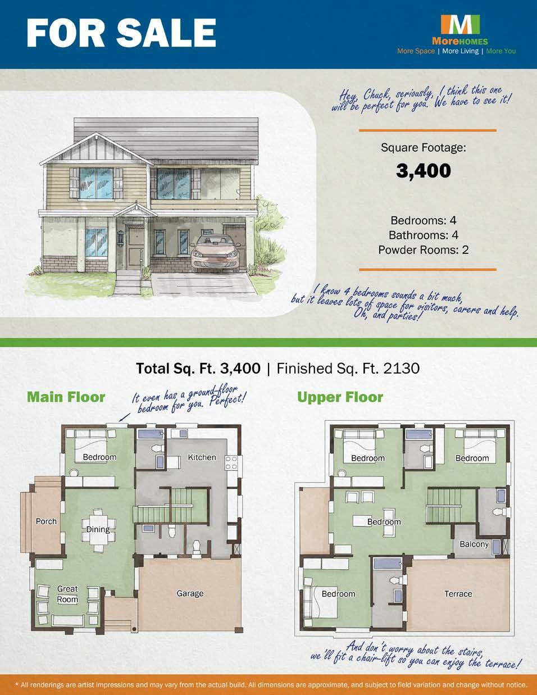

### Дом Чака Огла

*На странице — рекламный листок агентства недвижимости с фасадом дома и поэтажными планами; на полях — рукописные пометки. Перевод надписей:*

- **Заголовок:** «Продаётся». Логотип агентства «MoreHomes» («Больше домов»): «Больше места | Больше жизни | Больше тебя».
- **Пометка от руки (вверху):** «Чак, серьёзно, по-моему, этот тебе идеально подойдёт. Надо его посмотреть!»
- **Общая площадь:** около 316 м² (в оригинале 3400 кв. футов). **Спален:** 4. **Ванных комнат:** 4. **Туалетов для гостей:** 2.
- **Пометка от руки:** «Знаю, четыре спальни — многовато, но зато полно места для гостей, сиделок и помощников. Ну и для вечеринок!»
- **Строка над планами:** «Общая площадь — около 316 м² | Отделанная площадь — около 198 м²» (в оригинале 3400 и 2130 кв. футов).
- **Первый этаж (Main Floor):** спальня (Bedroom), кухня (Kitchen), крыльцо (Porch), столовая (Dining), гостиная (Great Room), гараж (Garage). Пометка от руки со стрелкой к спальне: «Тут даже есть спальня для тебя на первом этаже. Идеально!»
- **Второй этаж (Upper Floor):** спальня (Bedroom) — четыре помещения так подписаны, балкон (Balcony), терраса (Terrace). Пометка от руки внизу: «И не волнуйся насчёт лестницы — поставим кресло-подъёмник, чтобы ты мог выходить на террасу!»
- **Сноска внизу:** «Все изображения — художественное представление и могут отличаться от готовой постройки. Все размеры приблизительны и могут меняться на месте и без предупреждения».

*Прим. перев.: в листке написано «Спален: 4», а на планах подписано пять спален (одна на первом этаже и четыре на втором).*
