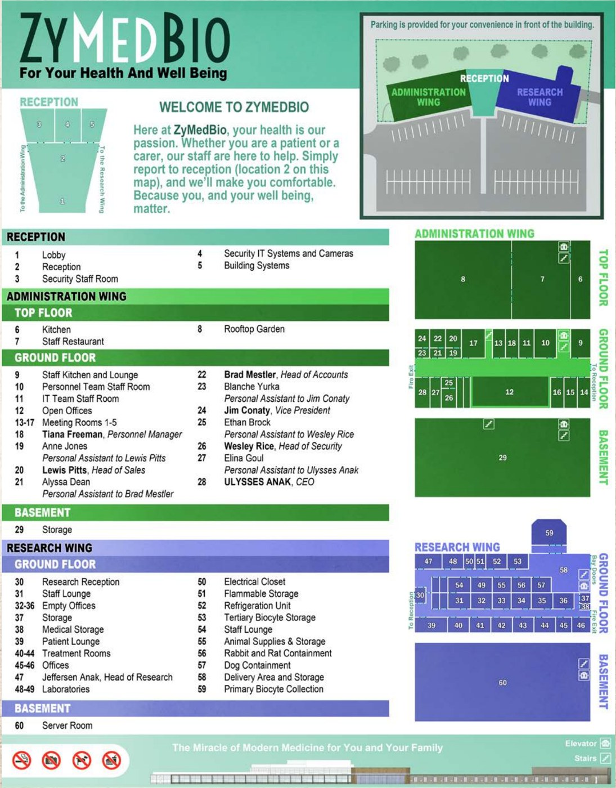

### Здание «ЗиМедБио»

*На странице — схема здания в виде рекламного листка компании. Перевод надписей:*

**«ЗиМедБио» — для вашего здоровья и благополучия**

**Добро пожаловать в «ЗиМедБио»!** Здесь, в «ЗиМедБио», ваше здоровье — наша страсть. Пациент вы или сопровождающий, наш персонал всегда готов помочь. Просто обратитесь к стойке охраны (место 2 на этой схеме), и мы позаботимся о вашем удобстве. Потому что вы и ваше благополучие важны.

*Общая схема:* «Для вашего удобства перед зданием есть парковка». Подписи: административное крыло, приёмный блок, исследовательское крыло. *Схема приёмного блока:* места 1–5; стрелки «В административное крыло» и «В исследовательское крыло».

| № | Приёмный блок |
|---|---|
| 1 | Вестибюль |
| 2 | Стойка охраны (приём посетителей) |
| 3 | Комната охраны |
| 4 | Пост видеонаблюдения (ИТ-системы охраны и камеры) |
| 5 | Пульт систем здания |

| № | Административное крыло — верхний этаж |
|---|---|
| 6 | Кухня |
| 7 | Ресторан для персонала |
| 8 | Сад на крыше |

| № | Административное крыло — первый этаж |
|---|---|
| 9 | Кухня и комната отдыха персонала |
| 10 | Комната отдела кадров |
| 11 | Комната ИТ-отдела |
| 12 | Открытый офис |
| 13–17 | Переговорные 1–5 |
| 18 | **Тиана Фримен**, *руководитель отдела кадров* |
| 19 | Энн Джонс, *личная помощница Льюиса Питтса* |
| 20 | **Льюис Питтс**, *руководитель отдела продаж* |
| 21 | Алисса Дин, *личная помощница Брэда Местлера* |
| 22 | **Брэд Местлер**, *руководитель бухгалтерии* |
| 23 | Бланш Юрка, *личная помощница Джима Конати* |
| 24 | **Джим Конати**, *вице-председатель* |
| 25 | Итан Брок, *личный помощник Уэсли Райса* |
| 26 | **Уэсли Райс**, *начальник охраны* |
| 27 | Элина Гоул, *личная помощница Улисса Анака* |
| 28 | **Улисс Анак**, *генеральный директор* |

| № | Административное крыло — подвал |
|---|---|
| 29 | Кладовая |

| № | Исследовательское крыло — первый этаж |
|---|---|
| 30 | Приёмная исследовательского крыла |
| 31 | Комната отдыха персонала |
| 32–36 | Пустые кабинеты |
| 37 | Кладовая |
| 38 | Склад медикаментов |
| 39 | Комната отдыха пациентов |
| 40–44 | Процедурные |
| 45–46 | Кабинеты |
| 47 | **Джефферсон Анак**, *руководитель исследований* |
| 48–49 | Лаборатории |
| 50 | Электрощитовая |
| 51 | Кладовая горючих веществ |
| 52 | Холодильная камера |
| 53 | Хранилище третичного биоцита |
| 54 | Комната отдыха персонала |
| 55 | Склад кормов и принадлежностей для животных |
| 56 | Виварий кроликов и крыс |
| 57 | Собачий вольер |
| 58 | Зона разгрузки и склад |
| 59 | Забор первичного биоцита |

| № | Исследовательское крыло — подвал |
|---|---|
| 60 | Серверная |

*На поэтажных планах:* «Пожарный выход», «К приёмному блоку», «Ворота разгрузки» (Bay Doors); условные знаки — «Лифт», «Лестница». *Внизу:* «Чудо современной медицины — для вас и вашей семьи»; значки запретов (не курить, не фотографировать, с собаками нельзя, еду и напитки не приносить).

*Прим. перев.: на плане имя напечатано «Jeffersen Anak» — опечатка, в тексте всюду «Jefferson».*
