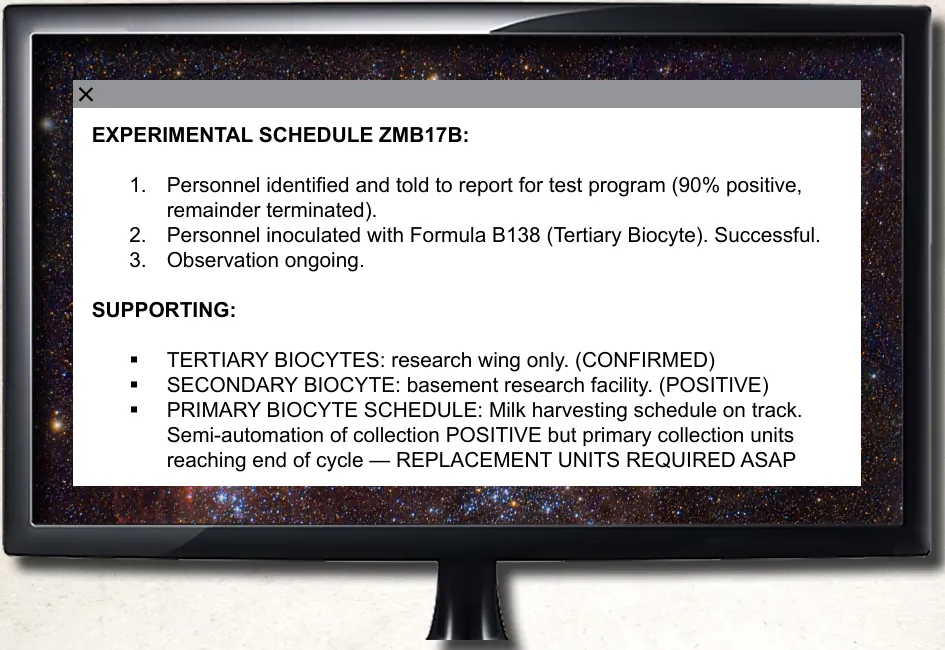

Он, похоже, не сознаёт своего состояния и куда больше озабочен и одержим налоговыми декларациями, платежами по кредитам и счетами. Общение с ним странное, но не угрожающее.

Если сыщики заговорят с Местлером о том, что он чудовище, он ответит: «Со мной всё в порядке», — но затем начнёт трястись и дрожать. Вдруг он разрывает на себе рубашку: кожа на его животе раздирается огромным ртом, и он начинает квакать так громко, что сыщики должны пройти проверку ВЫН, иначе получают 1 урон за каждый раунд, пока находятся рядом с ним. Потребуйте ещё одну проверку Рассудка (потеря 1/1d4). Кроме того, он бросается в атаку, кусаясь новообразовавшимся ртом на животе. Он дерётся так, пока его не усмирят или не убьют, или пока он не получит серьёзную рану — тогда он выбегает в большой офис и прячется под одним из столов открытого офиса.

### Кабинет Джима Конати

Рядом с кабинетом Брэда Местлера — кабинет Бланш Юрки, а за ним — кабинет Джима Конати. Чтобы попасть в комнату Конати, сыщики должны пройти через небольшой приёмный кабинет Бланш. Внутри горит свет, и сыщики видят Бланш такой, какая она теперь, — женщиной-птицей, сатиром; потребуйте проверку Рассудка (потеря 1/1d3).

Губы Бланш превратились в зачаточный клюв, волосы — в белые перья, а пальцы — в длинные птичьи когти. Она ведёт себя как птица: её глаза впиваются в людей, голова дёргается туда-сюда, когти цепляются за предметы, и двигается она быстро.

Сейчас Бланш сидит в интернете и напевает себе под нос. Увидев сыщиков, она начинает насвистывать нараспев про «Несанкционированный доступ». Если сыщики попытаются пройти мимо неё в кабинет Конати, она вскакивает и бросается на них (потребуйте проверку Уклонения, чтобы увернуться от Бланш). Если сыщики успешно уклоняются, Бланш пролетает мимо них, громко бьётся головой о стену и теряет сознание. В противном случае её первый натиск наносит 1d4 урона, и сыщики должны усмирить или убить её, чтобы прекратить нападения. Если сыщикам удастся поговорить с Бланш (после того как она очнётся или если её усмирят), она рассуждает о «Матери» туманно, но гораздо конкретнее говорит об «амебозоях», о вторичном и первичном биоцитах, о доении матери (и о том, что птицы молока не дают) и так далее — сведения для неё см. во врезке «Молоко Шуб-Ниггурат», с. 70.

Запасные ключи Джима Конати на самом деле лежат в ящике стола Бланш; больше ничего интересного там нет.

В кабинете Конати пусто, хотя его компьютер включён, а на экране открыто окно с сообщением — см. раздатку «Панацея» 2.

### Раздатка: «Панацея» 2

> **Раздатка «Панацея» 2**
>
> **График эксперимента ЗМБ17Б:**
>
> 1. Сотрудники идентифицированы и получили распоряжение принять участие в программе испытаний (90% успешно, остальные устранены).
> 2. Сотрудникам введена формула Б138 (третичный биоцит). Успешно.
> 3. Наблюдение продолжается.
>
> **Поддержание:**
>
> - ТРЕТИЧНЫЕ БИОЦИТЫ: только исследовательское крыло. (Подтверждено)
> - ВТОРИЧНЫЙ БИОЦИТ: подвал исследовательского крыла. (Положительно)
> - ГРАФИК ПЕРВИЧНОГО БИОЦИТА: график забора молока налажен. Полуавтоматический забор ПОЛОЖИТЕЛЬНО, но первичные агрегаты забора достигают конца рабочего цикла — СРОЧНО ЗАМЕНИТЬ АГРЕГАТЫ ЗАБОРА.

*Текст раздатки — по официальному русскому изданию раздаток «Кошмаров цифровой эпохи».*
