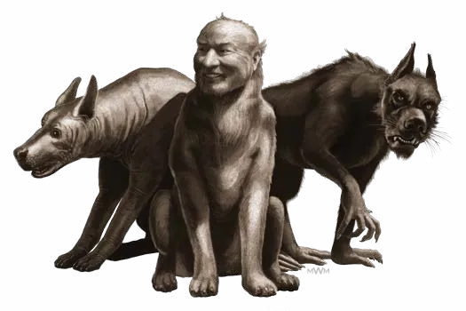

так далее. Если сыщик заговорит с собаками, они затихают и слушают, и можно даже поговорить (хотя некоторые собаки не могут сдержаться и время от времени выкрикивают просьбы). Собаки утверждают, что ничего не знают, кроме того, что им нравится, когда их кормят, особенно тем «вкусным молоком», и что они хотят на волю (некоторые собаки неплохо постарались прогрызть проволочную сетку клеток). Собаки просто хотят, чтобы их выпустили, и обещают никого не обижать.

Если собак выпустить, они стаей бросаются искать выход из здания (собаки с человеческими руками умеют открывать двери). Хотя на сыщиков они не нападают (если их не провоцировать), они могут доставить хлопот и отвлечь внимание. Хранителю решать, вырвется ли эта стая мутировавших собак из здания и убежит ли в ночь, чтобы сеять хаос в других местах; со временем ими овладеет безумие, собаки проголодаются и станут свирепыми охотниками, опасными для всех, кто встанет у них на пути.

Рядом с комнатой, где держат собак, — другая, с более мелкими лабораторными животными: кроликами, мышами и крысами. Большинство из них выглядят нормально, но у одного-двух явно видны признаки мутации.

#### Хранилище третичного биоцита

Сквозь большие окна из листового стекла сыщики могут заглянуть в это помещение; на двери табличка «Хранилище третичного биоцита». Внутри на рядах полок стоят колбы с тягучей белой жидкостью, похожей на сгустки. Жидкость шевелится, словно живая, и кое-где, похоже, вытолкнула пробки из колб, так что жуткая на вид белая слизь выбралась наружу. И правда, капли вязкой жидкости ползут вверх по окнам комнаты.

Пока сыщики смотрят, рядом появляется Джим Конати и рявкает: «Стоять! У вас большие неприятности!» Если с ними Марина Колга, Конати обращается к ней по имени. Он бежит к ним с криком: «Отойдите от амебозоев!»

Конати истощён и тощ. Теперь он отчасти олень: руки и ноги оканчиваются копытами, лицо вытянулось, изо лба растут рога (проверка Рассудка, потеря 1/1d3). Он не нападает сразу, так как всё ещё цепляется за остатки рассудка (скоро он окончательно обезумеет). Поэтому, в зависимости от ответа сыщика, он может немного поговорить и кое-что объяснить о том, что происходит. Речь у него несколько невнятная: «Вторичный биоцит — вот ключ. Он вызывает орган первичного биоцита, который производит молоко. Сборщики собирают молоко, а потом мы его перерабатываем. Если его достаточно нагреть, оно становится третичными биоцитами. Но если держать его в холоде, оно оказывается сильнейшим лекарством от всех болезней. Это поистине чудесно! Но равновесие так трудно соблюсти. Это очень-очень трудно. Так трудно…» С этими словами он словно ломается и пытается убежать к Доильне; если дверь в Доильню ещё не открыта, он пытается её открыть.

Если на Конати напасть, он защищается, но не прибегает к насилию. Он пытается улизнуть и спрятаться, хныча, в углу. В конце концов остатки человечности покинут его, и тогда он станет звероподобным и агрессивным.

Сыщики, решившие открыть дверь к амебозоям, подвергают себя опасности. Амебозои могут нападать, падая с потолка или внезапно прыгая на находящихся рядом людей или животных. Молочные сгустки прилипают к плоти или пытаются проникнуть через рот, уши или глаза. Амебозой быстро (за 1d3+1 раунда) проникает в тело, вызывая стремительные изменения по мере того, как сливается с носителем, и запуская мутацию в ещё более причудливого и менее похожего на человека сатира — одного из тысячи младых Шуб-Ниггурат (см. характеристики большего сатира, с. 99).

#### Зона разгрузки

За задним коридором здание открывается в зону разгрузки. Большие ворота позволяют доставлять оборудование и припасы. Рядом — два металлических бака высотой около 3 м возле того, что выглядит как пульт управления, установленный у пары укреплённых металлических дверей с надписью «Забор первичного биоцита» (они ведут в Доильню, см. далее). Справа — дверь с надписью «Подвал. Посторонним вход воспрещён» (см. «Подвал восточного крыла», с. 95). Повсюду как попало разбросаны тележки и коробки с медицинскими припасами. На одной из стен — пара свёрнутых пожарных рукавов, рядом — огнетушители.

Осмотрев пульт у укреплённых дверей, сыщики видят ряд органов управления: успешная проверка Механики или Науки (инженерия) либо трудная проверка Знаний позволяет понять, что пульт управляет системой труб, которые выходят из помещения за укреплёнными дверями и ведут в два больших бака. Кроме того, на пульте есть управление нагревателями и охладителями (они стоят под баками), регулирующими температуру баков. У обоих баков внизу — краны с резьбовыми патрубками, чтобы сливать содержимое. Сыщики, решившие открыть кран, обнаружат, что из него хлынул поток амебозоев (подробнее см. «Хранилище третичного биоцита»).
