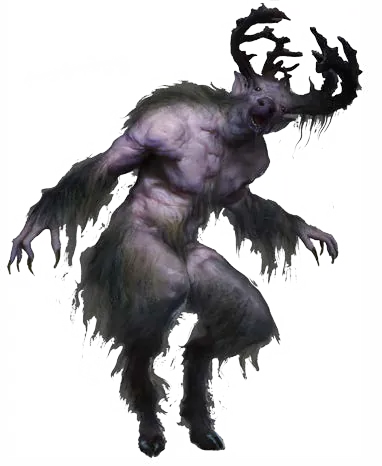

### Тед Доусон, *57 лет, начальник полиции*

Доусон на пути к превращению в меньшего сатира (характеристики показывают частичное действие «Зилактиса»); если сыщики встретят его позже по ходу сценария, Хранителю следует использовать профиль меньшего сатира.

```stat
СИЛ 70    ВЫН 90    ТЕЛ 65    ЛВК 60    ИНТ 75
НАР 40*   МОЩ 60    ОБР 70    Рассудок 38   ПЗ 15
БкУ: +1d4   Комплекция: 1   Скорость: 7   ПМ: 12
* До мутации.

Бой
Атак за раунд: 1 (укус, коготь)
Ближний бой           50% (25/10), урон 1d4+1d4
Уклонение             40% (20/8)

Навыки: Красноречие 50%, Первая помощь 45%, Запугивание 80%, Прыжки 50%, Юриспруденция 50%, Слух 60%, Психология 55%, Внимание 40%, Скрытность 35%, Метание 50%.

Потеря Рассудка: 1/1d3 при виде мутаций Доусона.
```

*Прим. перев.: Психология 55% — как в статблоке оригинала; в «Действующих лицах» (с. 73) сказано, что у Доусона Психология 80%. Скорость 7 — как напечатано (по характеристикам с поправкой на возраст 50+ было бы 6).*

### Энтони Каллисон, *48 лет, редактор*

Каллисон на пути к превращению в меньшего сатира (характеристики показывают частичное действие «Зилактиса»); если сыщики встретят его позже по ходу сценария, Хранителю следует использовать профиль меньшего сатира.

```stat
СИЛ 40    ВЫН 90    ТЕЛ 45    ЛВК 75    ИНТ 85
НАР 55*   МОЩ 60    ОБР 80    Рассудок 38   ПЗ 13
БкУ: 0    Комплекция: 0   Скорость: 8   ПМ: 9
* До мутации.

Бой
Атак за раунд: 1 (укус, коготь)
Ближний бой           45% (22/9), урон 1d4
Уклонение             45% (22/9)

Навыки: Искусство/ремесло (журналистика) 80%, Обаяние 40%, Красноречие 60%, Слух 45%, Психология 30%, Внимание 80%, Скрытность 70%, Метание 30%.

Потеря Рассудка: 1/1d3 при виде мутаций Каллисона.
```

*Прим. перев.: в оригинале — «for seeing Master's mutations» («мутаций Хозяина»), остаток шаблона; по смыслу — Каллисона. ПМ 9 — как напечатано, хотя при МОЩ 60 должно быть 12.*

### Меньший сатир

Используйте этот профиль для Джима Конати, Бланш Юрки, Брэда Местлера и Беатрис Эйприл.

| Характеристика | Среднее | Бросок |
|---|---|---|
| СИЛ | 60 | 3d6 ×5 |
| ВЫН | 90 | (5d6) ×5 |
| ТЕЛ | 65 | (2d6+6) ×5 |
| ЛВК | 80 | (3d6+6) ×5 |
| ИНТ | 60 | (3d6) ×5 |
| МОЩ | 50 | 3d6 ×5 |

```stat
Средние ПЗ: 15
Средняя Комплекция: 0
Средний БкУ: 0
Средняя Скорость: 8
Средние ПМ: 10

Бой
Атак за раунд: 1 (зависит от мутации: коготь, укус,
хвост, язык и т. п.)
Ближний бой           50% (25/10), урон 1d6+БкУ
Уклонение             40% (20/8)

Навыки: Лазание 40%, Прыжки 40%, Слух 40%, Скрытность 50%, Метание 45%.

Броня: нет.
Заклинания: нет.
Потеря Рассудка: 1/1d3 при виде меньшего сатира (повышается до 1/1d4 или 1/1d6 при особенно жутких мутациях).
```

*Прим. перев.: так в оригинале — СИЛ 60 и ИНТ 60 при броске 3d6×5 (среднее около 50).*


