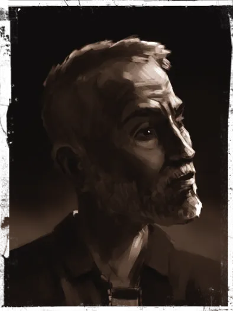

## Готовые сыщики

### Уэйд Ботелер



**Возраст:** 54 года. **Род занятий:** консультант по безопасности.

```stat
СИЛ 80    ВЫН 65    ТЕЛ 55    ЛВК 70    ИНТ 85
НАР 75    МОЩ 70    ОБР 80    Рассудок 70   ПЗ 12
БкУ: +1d4   Комплекция: 1   Скорость: 7   ПМ: 14   Удача: 45

Бой
Ближний бой (драка)            50% (25/10), урон 1d3+1d4
Стрельба (автоматический
пистолет 38-го калибра)        60% (30/12), урон 1d10
Стрельба (винтовка
калибра .30–06)                50% (25/10), урон 2d6+4
Уклонение                      40% (20/8)

Навыки
Взлом 40% (20/8)
Внимание 45% (22/9)
Запугивание 45% (22/9)
Красноречие 40% (20/8)
Лазание 60% (30/12)
Метание 40% (20/8)
Механика 35% (17/7)
Первая помощь 45% (22/9)
Плавание 50% (25/10)
Прыжки 50% (25/10)
Психология 45% (22/9)
Работа в библиотеке 45% (22/9)
Работа с компьютером 50% (25/10)
Скрытность 40% (20/8)
Слух 40% (20/8)
Средства 25% (12/5)
```

**Бонус:** распределите 40 пунктов между любыми навыками на выбор игрока.

#### Предыстория

Вы тридцать лет прослужили в армии в сержантском корпусе. Выйдя в отставку, вы постепенно взялись за частный сыск, назвавшись «консультантом по безопасности», поскольку так и не получили лицензию частного детектива. У вашей матери несколько лет назад случился инсульт — теперь она живёт в доме престарелых, где вы её часто навещаете.

Три недели назад вас наняла фармацевтическая компания «ЗиМедБио», предложив 23 000 долларов, чтобы проследить за «опасной недовольной бывшей сотрудницей» по имени Марина Колга. Начав наблюдение, вы быстро поняли, что Колга ведёт тихую жизнь. Взломав её компьютер (у неё не было никаких мер безопасности), вы выяснили, что она любит романтические комедии, не смотрит порно и активно ищет работу. Вы послали свои наблюдения «ЗиМедБио», и через несколько дней они попросили «привести её ночью для дальнейших расспросов». Что за чёрт? Консультант по безопасности подобным не занимается. В компании сказали, что вы получите остаток гонорара, только если приведёте её в «ЗиМедБио», — пока вам выплатили только 2750 долларов. Вы начинаете испытывать подозрения насчёт намерений «ЗиМедБио». Незаконное применение насилия — черта, которую вы не готовы пересекать.

В ходе расследования вы выяснили, что Колга собирается посетить вечеринку своего соседа Чака Огла. Вы планируете проникнуть на вечеринку, понаблюдать за Колгой и там решить, настаивать ли на том, чтобы она отправилась в «ЗиМедБио» в вашем сопровождении. Если вам удастся её уговорить, то сможете потребовать свои деньги по прибытии в здание «ЗиМедБио», а также убедиться в её безопасности, оставшись там в ходе расспроса.

#### Значимые люди

- **Марина Колга (персонаж игрока):** молодая юристка, за которой вам поручили проследить в «ЗиМедБио». Она напоминает вам собственную дочь (которая давно выросла и далеко переехала).
- **Гас Филипс (персонаж игрока):** кабинетный полицейский, которого вы несколько раз видели, когда заходили в участок. Пришёл на вечеринку с женщиной. Вы едва знакомы. Вы помните его имя, да, но сомневаетесь, что он помнит ваше.
- **Чак Огл (персонаж Хранителя):** парень, который устроил вечеринку.
- **Джим Конати (персонаж Хранителя):** ваш контакт в «ЗиМедБио». Худой тип лет пятидесяти. Из тех людей, которые при встрече пытаются размозжить руку своим мужественным рукопожатием, как будто вы меряетесь тестостероном. Какой же неудачник.
- **Бланш Юрка (персонаж Хранителя):** личная помощница Конати. Большая часть электронных писем и звонков поступала от неё. Вы никогда не встречались лично.

*Прим. перев.: лист готового сыщика дан по официальному русскому изданию («Кошмары цифровой эпохи»). В оригинале: винтовка «50% (35/14)» — опечатка в долях (верно 25/10); Колга названа кузиной Чака Огла («her cousin»), хотя она его соседка (в русском листе — «своего соседа»).*
