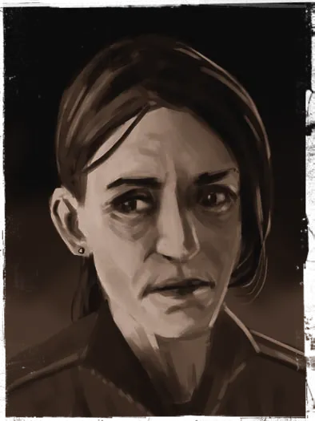

### Мэри Фуллер



**Возраст:** 44 года. **Род занятий:** медсестра.

```stat
СИЛ 55    ВЫН 75    ТЕЛ 50    ЛВК 75    ИНТ 80
НАР 55    МОЩ 60    ОБР 75    Рассудок 60   ПЗ 12
БкУ: 0    Комплекция: 0   Скорость: 8   ПМ: 12   Удача: 45

Бой
Ближний бой (драка)   35% (17/7), урон 1d3
Уклонение             35% (17/7)

Навыки
Внимание 30% (15/6)
Лазание 25% (12/5)
Медицина 35% (17/7)
Метание 30% (15/6)
Наука (биология) 50% (25/10)
Наука (фармакология) 40% (20/8)
Обаяние 45% (22/9)
Первая помощь 80% (40/16)
Прыжки 30% (15/6)
Психоанализ 30% (15/6)
Психология 40% (20/8)
Работа в библиотеке 25% (12/5)
Работа с компьютером 70% (35/14)
Скрытность 30% (15/6)
Слух 40% (20/8)
Средства 22% (11/4)
```

**Бонус:** распределите 40 пунктов между любыми навыками на выбор игрока.

#### Предыстория

Вы работящая медсестра из больницы в центре города. Вы дважды выходили замуж, но уже три года вы в разводе. Ваша лучшая подруга — Сисси Ричардс, тоже разведённая.

У вас есть кузен по имени Чак Огл, который серьёзно болен диабетом 2-го типа. Зрение Чака становилось всё хуже, а восемь месяцев назад ему пришлось ампутировать обе ноги до колена. Несколько недель назад он пропал. Ваша тётя сказала, что он «проходит лечение» в фармацевтической компании под названием «ЗиМедБио».

На прошлой неделе Чак вдруг позвонил вам и пригласил на вечеринку, которую собрался устроить. Он ничего не объяснил, и вы опасаетесь, что так Чак собирается попрощаться с друзьями и близкими перед смертью. В любом случае вы решили пойти. Гас Филипс, брат вашей лучшей подруги и полицейский, почему-то заинтересовался этой вечеринкой (или, может быть, вами?), так что вы взяли его как пару.

#### Значимые люди

- **Гас Филипс (персонаж игрока):** брат Сисси Ричардс и полицейский. Он услышал, что вы идёте на вечеринку, и предложил пойти вместе.
- **Белинда Норвич (персонаж игрока):** доктор в вашей больнице, которая тоже идёт на вечеринку. Вы нечасто работаете с ней непосредственно (вы медсестра скорой помощи, а она занимается хроническими пациентами).
- **Чак Огл (персонаж Хранителя):** кузен. Он тяжело болен и прошёл лечение в «ЗиМедБио». Теперь он устроил вечеринку, и вы надеетесь, что она не прощальная.
- **Сисси Ричардс (персонаж Хранителя):** лучшая подруга. После пятнадцати лет брака она развелась и получила свою долю имущества, так что дела у неё идут хорошо. Она открыла маленький цветочный магазин, чтобы занять себя.

*Прим. перев.: лист готового сыщика дан по официальному русскому изданию («Кошмары цифровой эпохи»). Уклонение 35% — как в оригинале, хотя по правилам оно не ниже ЛВК/2 = 37%.*
