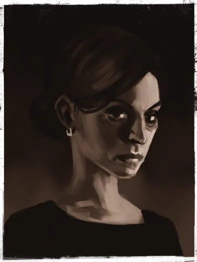

### Белинда Норвич



**Возраст:** 42 года. **Род занятий:** врач.

```stat
СИЛ 45    ВЫН 40    ТЕЛ 55    ЛВК 70    ИНТ 70
НАР 75    МОЩ 70    ОБР 90    Рассудок 70   ПЗ 9
БкУ: 0    Комплекция: 0   Скорость: 7   ПМ: 14   Удача: 45

Ближний бой (драка)   25% (12/5), урон 1d3
Уклонение             35% (17/7)

Навыки
Внимание 45% (22/9)
Медицина 75% (37/15)
Метание 30% (15/6)
Наука (биология) 45% (22/9)
Наука (фармакология) 50% (25/10)
Наука (химия) 55% (27/11)
Обаяние 40% (20/8)
Первая помощь 65% (32/13)
Психология 40% (20/8)
Работа в библиотеке 35% (17/7)
Скрытность 30% (15/6)
Слух 35% (17/7)
Средства 36% (18/7)
Убеждение 40% (20/8)
Юриспруденция 25% (12/5)
```

**Бонус:** распределите 40 пунктов между любыми навыками на выбор игрока.

#### Предыстория

Вы врач в крупной больнице. Вы идеалистка, но вам приятно думать, что вы смотрите на мир рационально. Вы участвуете в исследовании серповидноклеточной анемии, хотите улучшить жизни людей и оказывать им медицинскую помощь.

Недавно один из ваших пациентов с серповидноклеточной анемией рассказал вам, что пройдёт бесплатный курс лечения в «ЗиМедБио». Его заболевание неизлечимо, а симптомы едва удаётся устранить, так что это вас заинтриговало. Ваш пациент вернулся после курса лечения со словами, что «исцелился». Вы попросили его прийти на обследование, но он так и не явился. Ваш секретарь позвонил ему несколько раз — судя по всему, у него всё хорошо. Ему даже не требуется принимать никаких препаратов или добавок — удивительно и, на ваш взгляд, невозможно.

Вы безуспешно пытались обсудить этот вопрос непосредственно с представителями «ЗиМедБио». Вы озадачены и хотите больше узнать об этом курсе лечения. Медсестра из вашей больницы, Мэри Фуллер, упоминала, что её кузен (Чак Огл) проходил схожие процедуры в «ЗиМедБио». После них он решил устроить вечеринку, и вы решили на неё пойти в надежде, что узнаете подробности о «ЗиМедБио» и их препаратах.

#### Значимые люди

- **Мэри Фуллер (персонаж игрока):** медсестра из вашей больницы. Она также удачным образом приходится кузиной Чаку Оглу, который устраивает вечеринку.
- **Чак Огл (персонаж Хранителя):** вам говорили, что он тяжело болен и прошёл курс лечения в «ЗиМедБио». Теперь он устраивает вечеринку, на которую вы пришли с намерением вызнать у него что-либо о лечении в «ЗиМедБио».

*Прим. перев.: лист готового сыщика дан по официальному русскому изданию («Кошмары цифровой эпохи»). В оригинале на этом листе нет заголовка «Бой» (Combat) над строками драки и Уклонения.*
