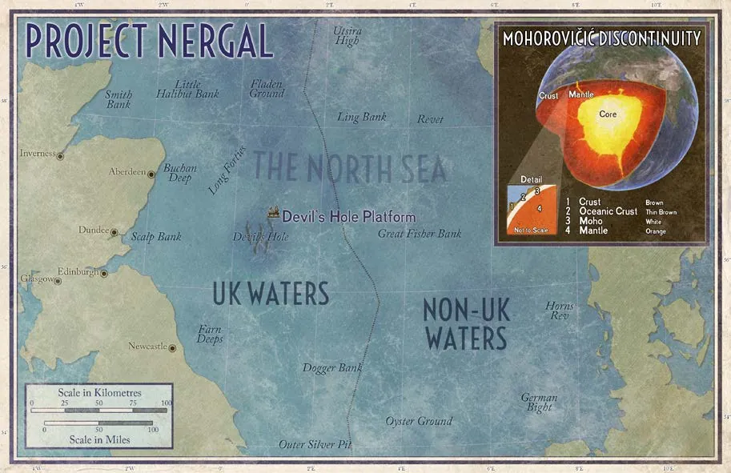

сыщики могут быть самых разных профессий: бухгалтер, специалист по управлению бизнесом или проектами, медик (в том числе психиатр), выборное лицо (в нашем случае — депутат парламента), юрист, офицер, инженер или учёный (геолог, химик, океанограф, физик-ядерщик). Хотя бы один сыщик должен быть учёным со специализацией в геологии, химии, ядерной физике или инженерном деле.

Игроки могут создать для сценария новых сыщиков, но можно взять и уже существующих персонажей наших дней. Хранителю стоит убедиться, что у существующих сыщиков есть подходящая квалификация, чтобы их включили в группу. Для тех же, кто хочет начать быстро, предлагаются шесть готовых сыщиков:

- Джессика Андерсон, учёная (геохимик) и руководительница команды
- Филипп Суонн, учёный (физик-ядерщик)
- Терри Дуглас, океанограф
- Виктор Манн, системный инженер и инженер-технолог
- Триша Хики, консультантка по персоналу
- Клэрис Уильямс, депутат парламента

Листы готовых сыщиков — начиная со с. 142.

> **Энергия Северного моря**
>
> Нефть и газ издавна добывают из месторождений под Северным морем. К 2016 году в Северном море ведётся самое активное в мире морское бурение: здесь работают 173 буровые установки.
>
> Северное море лежит на Европейском континентальном шельфе; его средняя глубина — 90 м, хотя некоторые участки гораздо глубже, например Дыра дьявола в 320 км к востоку от Данди (Шотландия). Дыра дьявола — это цепь несимметричных впадин длиной от 19 до 30 км и глубиной до 230 м. Своё адское название район получил от рыбаков, которые теряли сети на крутых склонах впадин.
>
> В Соединённом Королевстве Министерство бизнеса, энергетики и промышленной стратегии (BEIS) управляет снабжением энергией и ядерным топливом — поставками, инфраструктурой и выводом объектов из эксплуатации (до июля 2016 года этим занималось Министерство энергетики и изменения климата).
