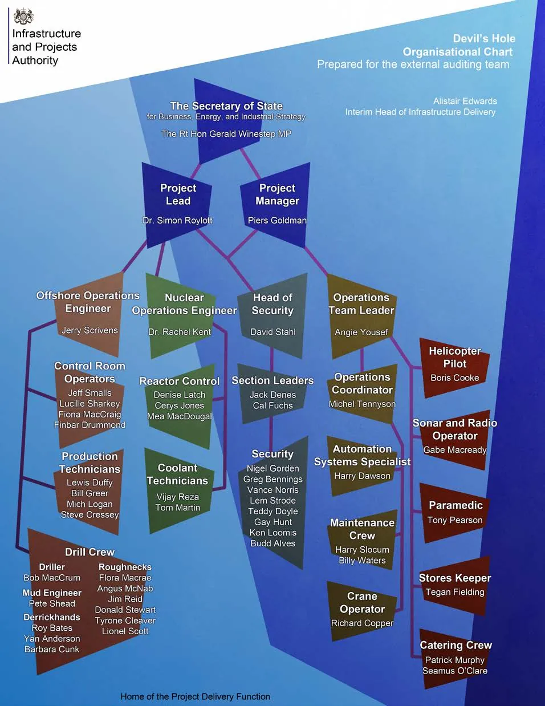

> **Раздатка: Организационная схема «Дыры дьявола»**
>
> **Управление инфраструктуры и проектов**
>
> **Организационная схема «Дыры дьявола»** *Подготовлено для внешней группы проверяющих*
>
> Алистер Эдвардс, временный глава управления по реализации инфраструктуры
>
> - **Министр по вопросам бизнеса, энергетики и промышленной стратегии** — достопочтенный Джеральд Уайнстеп, член парламента
>     - **Руководитель проекта** — доктор Саймон Ройлотт
>         - **Инженер морских операций** — Джерри Скривенс
>             - **Операторы диспетчерской:** Джефф Смоллс, Люсиль Шарки, Фиона Маккрейг, Финбар Драммонд
>             - **Техники производства:** Льюис Даффи, Билл Грир, Мич Логан, Стив Кресси
>             - **Буровая бригада:** бурильщик — Боб Маккрам; инженер по буровым растворам — Пит Шед; верховые — Рой Бейтс, Ян Андерсон, Барбара Канк; помбуры — Флора Макрей, Ангус Макнаб, Джим Рид, Дональд Стюарт, Тайрон Кливер, Лайонел Скотт
>         - **Инженер ядерной установки** — доктор Рэйчел Кент
>             - **Управление реактором:** Дениз Лэтч, Керис Джонс, Миа Макдугал
>             - **Техники системы охлаждения:** Виджай Реза, Том Мартин
>     - **Менеджер проекта** — Пирс Голдман
>         - **Начальник охраны** — Дэвид Шталь
>             - **Старшие смены:** Джек Денес, Кэл Фукс
>             - **Охрана:** Найджел Горден, Грег Беннингс, Вэнс Норрис, Лем Строуд, Тедди Дойл, Гэй Хант, Кен Лумис, Бадд Алвес
>         - **Руководитель операционной группы** — Энджи Юсеф
>             - **Координатор операций** — Мишель Теннисон
>                 - **Специалист по автоматике** — Гарри Доусон
>                 - **Ремонтники:** Гарри Слокум, Билли Уотерс
>                 - **Крановщик** — Ричард Коппер
>             - **Пилот вертолёта** — Борис Кук
>             - **Оператор гидролокатора и радист** — Гейб Макриди
>             - **Парамедик** — Тони Пирсон
>             - **Кладовщица** — Тиган Филдинг
>             - **Повара:** Патрик Мёрфи, Шеймус О’Клэр
>
> *Здесь работает служба реализации проектов*

*Прим. перев.: схема расходится с текстом сценария — так в оригинале: «Nigel Gorden» (в тексте Найджел Гордон), «Gay Hunt» (Гэри Хант), «Yan Anderson» (Ян Андерссон), «Fiona MacCraig» (Фиона Маккрейг), «Mich Logan» (Митч Логан), «Production Technicians» (в тексте — техники переработки); Голдман на схеме — «менеджер проекта» (в тексте — исполнительный директор, «представитель заказчика»). Начальник охраны Шталь на схеме связан и с руководителем проекта, и с менеджером проекта.*
