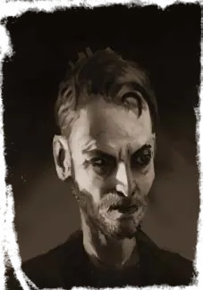

#### Джеральд Уайнстеп, *54 года, министр*

Уайнстеп недавно назначен министром по вопросам бизнеса, энергетики и промышленной стратегии. Этот сравнительно малоизвестный политик стремится изменить мнение о себе коллег и утвердиться как «игрок» и в правительстве, и в своей партии. Уайнстеп бросился в проект с головой и теперь ждёт результатов.

Лично Уайнстеп в сценарии не появляется, но Хранитель может устроить его звонок сыщикам в самом начале — чтобы показать, как ему нужен успех проекта, и дать сыщикам понять: он ждёт, что их проверка окажется не более чем «формальностью». Его в целом неприятная манера и завуалированные угрозы должны заставить сыщиков нервничать — как нервничает Пирс Голдман, государственный служащий, отвечающий за платформу.

Когда всё начнёт идти не так, связаться с Уайнстепом сыщики не смогут; а если каким-то образом всё же поговорят с ним, он станет ещё агрессивнее и потребует, чтобы они сами разобрались с положением. По его мнению, всё, кроме успешной поставки ролотного газа, совершенно неприемлемо.

- **Описание:** широкоплечий, коренастый, полноватый. Жемчужно-белая улыбка и тёплое рукопожатие скрывают алчную натуру.
- **Черты:** мелочен и третирует подчинённых; среди сотрудников министерства известен как тиран.
- **Зацепки для отыгрыша:** в сценарии остаётся за кадром; давит на Голдмана и на сыщиков, если у него сложится впечатление, что на платформе не всё в порядке. Не желает слушать ни оправданий, ни о проблемах — предпочитает сохранить возможность правдоподобно всё отрицать, если случится что-то по-настоящему плохое.

*Примечание: характеристик у Уайнстепа нет — физически в сценарии он не участвует.*

### Экипаж платформы

Персонажи Хранителя, которые заняты управлением, надзором и повседневной работой платформы «Дыра дьявола».

#### Пирс Голдман, *48 лет, представитель заказчика*

Голдман подчиняется напрямую Джеральду Уайнстепу, боится за своё место и смертельно боится доктора Ройлотта. Несмотря на карьеру, построенную на посредственной работе и умении прятаться в серых слоях государственной службы, Голдман довольно неожиданно для себя оказался на высокой должности и теперь отвечает не только за благополучие людей, работающих на платформе «Дыра дьявола», но и за результаты. И то и другое приносит Голдману бессонные ночи, несварение и язву желудка.

Зажатый между начальником-самодуром и маниакальной агрессией доктора Ройлотта, Голдман хотел бы оказаться где угодно, только не в изоляции посреди Северного моря без плана бегства. Предстоящая внешняя проверка проекта, как он искренне надеется, поможет закрыть проект. В последние недели к нему приходили разные люди и высказывали опасения насчёт безопасности — в основном потому, что доктор Ройлотт выжимает из персонала и оборудования больше допустимого. Все попытки Голдмана разобраться с Ройлоттом заканчивались тем, что его перекрикивали, а Ройлотт даже нажаловался на Голдмана Джеральду Уайнстепу, который, похоже, с удовольствием поддерживает Ройлотта и закручивает гайки Голдману. В итоге Голдман — пустой человек, которому всё это не по плечу и который не способен взять дело в свои руки: он сидит у себя в кабинете и позволяет Ройлотту фактически руководить всем изо дня в день.

- **Описание:** худой, словно недоедает; волосы поседели от постоянного стресса.
- **Черты:** нервничая, яростно протирает очки.
- **Зацепки для отыгрыша:** видит в сыщиках единственный способ закрыть проект и при первой возможности уступит им главенство. Он надеется отсидеться в кабинете и дать сыщикам самим обнаружить все неполадки, но при необходимости постарается обратить их внимание на тех работников, которые жаловались на безопасность.

#### Доктор Саймон Ройлотт, *53 года, руководитель проекта, под влиянием Цатхоггуа*

Проект «Нергал» — детище доктора Ройлотта. Когда-то почти никому не известный учёный, Ройлотт благодаря открытию ролотного газа поднял своё положение и авторитет в научных и политических кругах и получил доступ к значительному финансированию, которое — если ролотный газ станет неисчерпаемым источником энергии — может изменить мир.

Как и многие великие умы до него, Ройлотт всегда был чем-то вроде безумного гения: очень темпераментный, вспыльчивый и одержимый страстью. Его разум — как раз «подходящего» впечатлительного склада, чтобы поддаться потусторонним излучениям сущностей Мифов Ктулху. В самом деле, уже довольно давно Ройлотт получает мысленные послания от Великого Древнего Цатхоггуа. Не зная правды, лихорадочный разум Ройлотта
