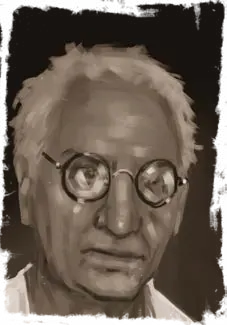
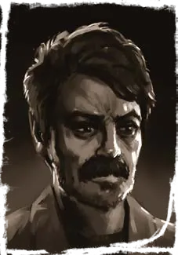

считает эти внушённые мысли своими собственными, и они толкнули его на замыслы пробурить планету до самого сердца. Поэтому к тому времени, когда сыщики с ним встретятся, разум Ройлотта повреждён безвозвратно: он полностью безумный психопат, сохранивший высокую работоспособность, — самовлюблённый, асоциальный и не знающий раскаяния. Главная цель Ройлотта — вскрыть Мохол; неважно, пострадают ли при этом люди или погибнут.

Последние несколько недель безумие Ройлотта стало проявляться внешне. Для общения с тем, что он называет «Высшим разумом», он пользуется сломанным компьютером у себя в кабинете. Он часами стучит по клавиатуре, и все считают, что Ройлотт усердно строит и проверяет компьютерные модели бурения; на самом деле он получает мысленные приказы от Цатхоггуа.

*Заметка для Хранителя: когда сыщики говорят с Ройлоттом или наблюдают за ним в кабинете, они всегда должны стоять перед его столом, чтобы не видеть экрана его компьютера. В разговоре Ройлотт отвечает на вопросы, не переставая печатать, — производит впечатление занятого и целеустремлённого профессионала. В подходящий момент, позже по ходу сценария, позвольте сыщикам попасть в его кабинет и обнаружить, что компьютер — пыльная, негодная к работе вещь, экран монитора разбит и покрыт трещинами, а у кабеля питания даже нет вилки — просто обрезанный провод. Осознание того, что доктор Ройлотт часами стучал по мёртвой клавиатуре, должно заставить сыщиков (и игроков) задуматься и, в идеале, ощутить нарастающий ужас!*

*Прим. перев.: в оригинале опечатка «a sense of mounting dead!» — имеется в виду «dread» («нарастающий ужас»).*

Если неуловимому Ройлотту предъявить обвинения в небезопасных методах работы или подобные претензии, он поначалу отмахивается, но быстро начинает злиться и обвиняет Голдмана (и всех, кто придёт ему в голову) в близорукости и в попытках опорочить его работу. Всякого, кто жалуется, он называет «ребёнком» и бросает в ответ, что ограниченные умы не способны постичь великое дело, которое он вершит. Он изменит мир, дав миллионам новую энергию. Те, кто не видит этой цели, — мелкие людишки и должны убраться с его дороги. Если на него надавить, Ройлотт обрушивает на своих «гонителей» поток брани и обвинений и вылетает прочь — запирается у себя в кабинете или бежит за помощью к Шталю. Цатхоггуа одарил Ройлотта способностью стирать у людей недавние воспоминания — этот трюк он уже начал применять (см. «Стирание памяти», с. 127).

- **Описание:** среднего роста, лысеющий, с белыми растрёпанными волосами; толстые очки с линзами, как бутылочное стекло, скрывают острый и проницательный взгляд (повысьте сложность проверок **Психологии** или наложите штрафную кость на попытки разгадать, что у Ройлотта на уме).
- **Черты:** легко впадает в гнев, вспыльчив, безжалостен и чрезвычайно хитёр.
- **Зацепки для отыгрыша:** полностью сосредоточен на том, чтобы ускорить бурение и добраться до Мохола. Винит других в желании сорвать дело его жизни. Принимает меры, чтобы никто не остановил бурение, — пользуется Шталем и его охраной, чтобы с «вредителями» разобрались.

#### Джерри Скривенс, *49 лет, инженер морских операций*

Скривенс — старший технический специалист по вопросам бурения на платформе. Последние несколько недель его беспокоит темп работы. По его мнению, доктор Ройлотт урезает запас безопасности, чтобы ускорить бурение; его люди работают круглые сутки и устали, и несчастный случай с ранениями или гибелью весьма вероятен. После жаркой перепалки с Ройлоттом (ничем не кончившейся) Скривенс пошёл со своими опасениями к Пирсу Голдману, который пообещал разобраться. Скривенс знает, что у Голдмана связаны руки и что ничего не изменится, пока кто-нибудь всерьёз не покалечится или не погибнет на работе; сам выступить он боится и надеется, что проверка сыщиков выявит нарушения безопасности и приведёт к переменам до того, как случится авария.

Скривенс в напряжении не только из-за режима работы, навязанного доктором Ройлоттом, но и из-за череды жутких кошмаров, которые мучают его последние полгода. Кошмары он списывает на растущее напряжение от сроков проекта. Во время двухнедельного отпуска на берегу кошмары прекратились, но по возвращении на «Дыру дьявола» вернулись с новой силой. На самом деле кошмары вызваны мысленными излучениями из подземного царства Н’кай, отчасти усиленными шевелением Цатхоггуа.

По усмотрению Хранителя Скривенс в любой момент может поддаться мысленной атаке и попасть под влияние Цатхоггуа.

- **Описание:** коренастый, ниже среднего роста, с густой гривой тёмно-каштановых волос и пышными усами.
- **Черты:** в целом дружелюбен, но не доверяет чужакам и тем, у кого власть (то есть сыщикам). Сейчас подавлен и в напряжении.
