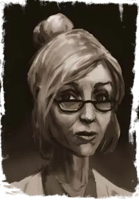
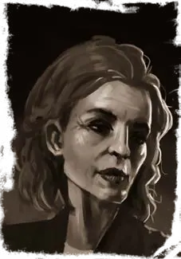

- **Зацепки для отыгрыша:** выжидает, что будут делать сыщики и можно ли им доверять. Может прийти к сыщикам со своими опасениями насчёт безопасности, но избегает обвинять кого-то конкретного: боится, что и он, и его бригада потеряют работу. Может внезапно попасть под власть Цатхоггуа.

#### Доктор Рэйчел Кент, *49 лет, инженер ядерной установки*

Доктор Кент отвечает за обслуживание и работу ядерного реактора, который питает бур платформы. Она известна как своего рода бунтарка в ядерной физике; её лично назначил Ройлотт, и она чувствует к нему сильную преданность. Доктору Кент дали реактор со списанной подводной лодки, и она гордится возможностью стать первым учёным, который перенастроил и приспособил реактор для глубоководного бурения. Когда проект в целом увенчается успехом (возможности провала она не видит), она рассчитывает на признание и богатство.

Последние полгода её всё больше беспокоил темп проекта: она боялась слишком нагрузить старый реактор, а тут ещё и журналы, которые она получала от группы управления реактором; однако, когда она подняла эти вопросы, доктор Ройлотт её успокоил (направляя волю Цатхоггуа, он заставил её забыть о тревогах). Так что теперь доктор Кент предана делу больше, чем когда-либо, рвётся продолжать работу и добыть ролотный газ и, похоже, не помнит о проблемах безопасности, о которых прежде говорили она сама и её группа.

Любопытные сыщики, которых может насторожить несколько беспечное отношение доктора Кент, могут найти её записи, похороненные у неё в кабинете, где изложены её опасения: в частности, активной зоне реактора нужны запасные части и остановка на техобслуживание, без которых продолжающаяся нагрузка на реактор может стать критической. Если предъявить ей её же записи, успешная проверка **Психологии** сыщика заставит доктора Кент «вспомнить» о своих опасениях, хотя она, похоже, не может вспомнить, почему о них забыла.

- **Описание:** почти болезненно худая, длинные светлые волосы обычно собраны в пучок, угловатые черты лица, очки для чтения.
- **Черты:** деловая и весьма прозаичная; во всём полагается на доктора Ройлотта.
- **Зацепки для отыгрыша:** отказывается говорить что-либо, что бросило бы тень на доктора Ройлотта, но открыто критикует Пирса Голдмана за отсутствие «видения». Говорит, что реактор работает прекрасно, и не любит, когда кто-то вмешивается в её работу (то есть шныряет у пульта управления реактором). Если предъявить ей её же записи, может вспомнить свои прежние опасения, но не то, почему совсем о них забыла, — и начинает сомневаться в своём душевном здоровье. Со временем может попасть под власть Цатхоггуа.

#### Энджи Юсеф, *53 года, руководитель операционной группы*

Юсеф входит в руководство и отвечает за операционные, а не технические вопросы. Её главная задача — следить, чтобы работа велась по нужным стандартам и с максимальной производительностью. В её ведении — вспомогательные системы, ремонт и обслуживание, работа кранов, а также диспетчерская платформы, медпункт, склады, кухня и пилот вертолёта Борис Кук.

Оказавшись меж двух огней в борьбе за власть между Голдманом и доктором Ройлоттом, Юсеф старается не высовываться. Слухи о проблемах с безопасностью среди технического и ремонтного персонала ей не в новинку, и она поднимала эти вопросы перед обоими начальниками, но толку от этого было мало. Ройлотта она считает самодуром, а Голдмана — беспомощным, но боится слишком ввязываться в их схватки, чтобы не потерять работу. Поскольку её главная задача — поддерживать успешное выполнение проекта, техническую сторону она оставляет специалистам, полагаясь на то, что Ройлотт знает, что делает.

Из всего руководства именно Юсеф скорее всех подружится с сыщиками и станет их проводником и хозяйкой. Твёрдых фактов о проблемах с безопасностью она дать не может, но может направить сыщиков в нужную сторону. Дэвида Шталя (с. 118) она недолюбливает, но понимает, что вооружённая охрана необходима из-за деликатного характера проекта.

- **Описание:** рыжевато-светлые волосы до плеч, видавший виды деловой костюм; вид у неё вечно усталый.
- **Черты:** весёлая и болтливая манера скрывает подавленную душу; склонна шутить не к месту.
- **Зацепки для отыгрыша:** дружится с сыщиками и водит их по платформе. Когда портится погода, её можно найти в диспетчерской — она следит за погодными условиями.
