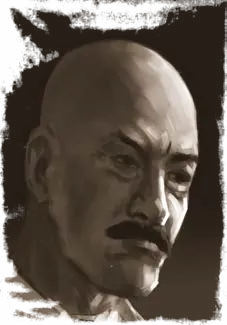

### Служба охраны

Охранники работают в «Фортудо» — частной компании, которую Джеральд Уайнстеп нанял охранять платформу. Отряд из десяти человек возглавляет Дэвид Шталь, грубый громила; охранники посменно патрулируют платформу или стерегут ключевые места вроде помещения пульта управления реактором.

Поначалу охрана не путается у сыщиков под ногами: она лишь выглядит угрюмой и угрожающей, а не представляет настоящей угрозы. Охранять сыщиков поручено Найджелу Гордону (он может стать заменой выбывшему персонажу игрока или удобным персонажем Хранителя, которого можно убить, чтобы показать опасность). По ходу сценария Шталь (и кое-кто из его людей) попадает под влияние Цатхоггуа, а следовательно, полностью подчиняется Ройлотту. Если сыщики (или кто-то ещё) начнут мутить воду, Ройлотт с помощью людей Шталя вводит на платформе «военное положение»; дело может дойти до развязки, если сыщики выступят против Шталя, — тогда он попытается схватить сыщиков и расстрелять их, выстроив перед расстрельной командой (см. «Безумие Шталя», с. 134).

#### Дэвид Шталь, *38 лет, начальник охраны*

Шталь и в лучшие-то времена напыщенный болван, сексист и наглец — он считает себя Божьим даром роду человеческому. В прошлой жизни Шталь был продажным копом в полиции Лос-Анджелеса и ушёл оттуда прежде, чем вскрылись его преступления. Теперь, работая на «Фортудо», он получил второй шанс отравлять жизнь окружающим.

В подходящий момент сценария разум Шталя трескается под влиянием Цатхоггуа, и в своём безумии он видит врагов повсюду — скорее всего, обвинит сыщиков в том, что они шпионы или даже террористы, которых нужно запереть или уничтожить. Такие события играют на руку замыслам Ройлотта, которому, возможно, тоже надоели назойливые сыщики и который хочет от них избавиться.

Учтите, что у Шталя в каюте есть мощная глушилка сотовой связи, которой он не даёт звать на помощь. Если Гейб Макриди ещё не вывел из строя радио, Шталь ставит в диспетчерской охрану, чтобы никто не мог воспользоваться системой связи. Кроме того, он посылает часть своих людей стеречь спасательные капсулы, чтобы «вредители» не покинули платформу.

- **Описание:** бритая голова, чёрные усы, глазки-бусинки.
- **Черты:** наглец, сексист и самодур.
- **Зацепки для отыгрыша:** обвиняет сыщиков в шпионаже, встаёт на сторону Ройлотта и в конце концов становится опасным психопатом, одержимым охотой на своих врагов.

> **Оружие Шталя и глушилка сотовой связи**
>
> В оружейном шкафу в кабинете Шталя хранится следующее (число будет меняться, поскольку часть этого оружия — у охранников на дежурстве):
>
> - 15 автоматов HK416;
> - 15 пистолетов «Глок» 17;
> - много боеприпасов.
>
> | Оружие | Урон | Базовая дальность | Выстрелов за раунд | Магазин | Осечка |
> |---|---|---|---|---|---|
> | Хеклер и Кох HK416 | 2d8 | 80 м | 1 (2) или автоматический огонь | 30 | 99 |
> | «Глок» 17 | 1d10 | 15 м | 1 (3) | 17 | 99 |
>
> Приём сотовой связи посреди Северного моря и так в лучшем случае неустойчив, но Шталь не рискует и включит свою глушилку, как только скатится в безумие, или по приказу Ройлотта.
>
> Глушилка не даёт сотовым телефонам принимать и передавать сигналы, фактически выводя такие устройства из строя. Глушилка Шталя — мощная американская модель, способная блокировать связь в радиусе 1,6 км; он держит её у себя в кабинете.

*Прим. перев.: осечка «Глока» 17 в таблице — 99 (в справочнике оружия — 98); так в оригинале.*
