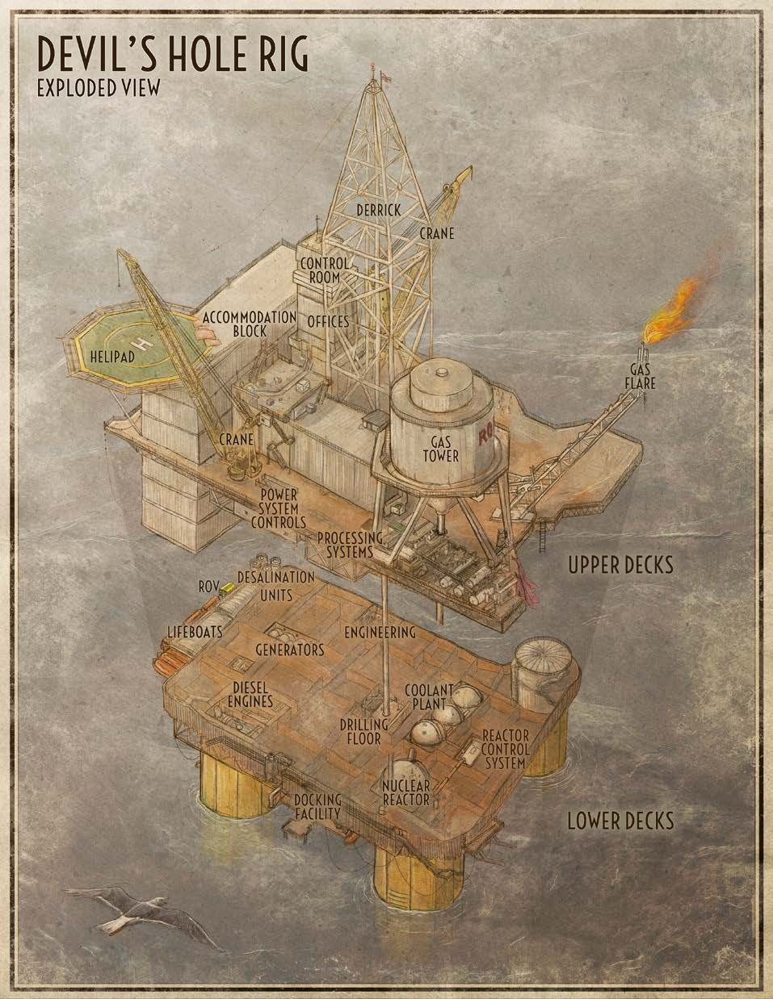

**План платформы «Дыра дьявола» (в разнесённом виде) — подписи:**

| Подпись на плане | Перевод |
|---|---|
| Derrick | буровая вышка |
| Crane (2) | краны (левый и правый) |
| Control Room | диспетчерская |
| Accommodation Block | жилой блок |
| Offices | кабинеты |
| Helipad | вертолётная площадка |
| Gas Flare | газовый факел |
| Gas Tower | газовая башня |
| Power System Controls | система управления энергоснабжением |
| Processing Systems | система переработки газа |
| Upper Decks | верхние палубы |
| ROV | телеуправляемый подводный аппарат (ТНПА) |
| Desalination Units | опреснители |
| Lifeboats | спасательные капсулы |
| Generators | генераторы |
| Engineering | мастерские |
| Diesel Engines | дизельные двигатели |
| Coolant Plant | установка охлаждения |
| Drilling Floor | буровая площадка |
| Reactor Control System | пульт управления реактором |
| Nuclear Reactor | ядерный реактор |
| Docking Facility | причал |
| Lower Decks | нижние палубы |
