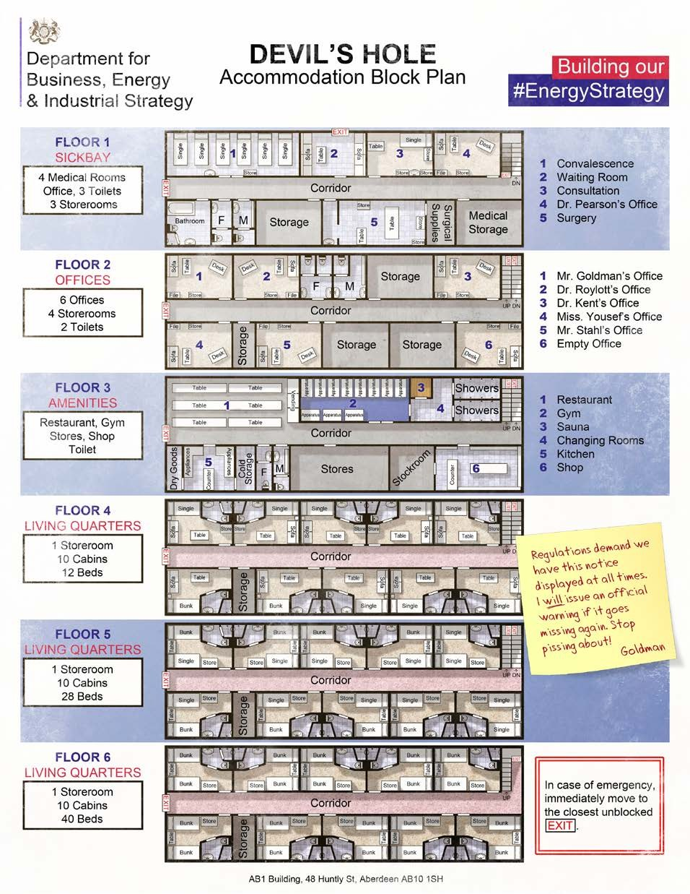

**Министерство бизнеса, энергетики и промышленной стратегии. «Дыра дьявола»: план жилого блока.** *«Строим нашу #ЭнергетическуюСтратегию».*

| Этаж | Назначение | Помещения на плане |
|---|---|---|
| Этаж 1 — медпункт | 4 медицинских помещения, кабинет, 3 туалета, 3 кладовые | 1 — палата для выздоравливающих; 2 — приёмная; 3 — смотровая; 4 — кабинет доктора Пирсона; 5 — операционная; а также ванная, хирургические материалы, склад медикаментов, кладовая |
| Этаж 2 — кабинеты | 6 кабинетов, 4 кладовые, 2 туалета | 1 — кабинет мистера Голдмана; 2 — кабинет доктора Ройлотта; 3 — кабинет доктора Кент; 4 — кабинет мисс Юсеф; 5 — кабинет мистера Шталя; 6 — пустой кабинет |
| Этаж 3 — удобства | столовая, спортзал, склады, магазин, туалет | 1 — столовая; 2 — спортзал; 3 — сауна; 4 — раздевалки (и душевые); 5 — кухня; 6 — магазин; а также сухие продукты, холодильная камера, склады, подсобка |
| Этаж 4 — жилой этаж | 1 кладовая, 10 кают, 12 коек | каюты с одиночными и двухъярусными койками |
| Этаж 5 — жилой этаж | 1 кладовая, 10 кают, 28 коек | то же |
| Этаж 6 — жилой этаж | 1 кладовая, 10 кают, 40 коек | то же |

На плане также: коридор (Corridor) и выходы (Exit) на каждом этаже, лестницы вверх и вниз (Up, Dn).

> *Записка, приклеенная к плану:* «По правилам это объявление должно висеть всё время. Если оно опять пропадёт, я **объявлю** официальный выговор. Хватит валять дурака! — Голдман»

> *Табличка:* «При чрезвычайной ситуации немедленно пройдите к ближайшему свободному ВЫХОДУ».

*Адрес внизу плана: AB1 Building, 48 Huntly St, Aberdeen AB10 1SH.*

*Прим. перев.: в подписи страницы — «Accomodation» (вместо «Accommodation»); на плане — «кабинет доктора Пирсона», хотя Тони Пирсон — парамедик; так в оригинале.*
