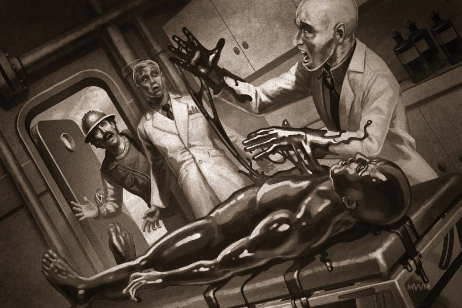

надеть перчатки, чтобы не касаться слизи, которая явно действует на корчащегося ремонтника.

В медпункте Тони Пирсон делает всё, что в его силах, но успешная проверка **Психологии** подтверждает: ему это явно не по плечу, и он не знает, как лечить Слокума. Сначала Пирсон пробует воду, физраствор, а потом шпатель, чтобы соскрести слизь с кожи Слокума, — всё без толку.

Пирсон благодарен за любую помощь и позволяет сыщикам экспериментировать сколько душе угодно, пока не покажется, что они делают только хуже, — в таком случае Пирсон прекращает то, что делает сыщик, и выставляет его из медпункта. Проверки **Первой помощи** и **Медицины** ничего не дают, если только сыщик не догадается подвергнуть слизь действию тепла или холода — тогда слизь заметно реагирует. Кроме того, сыщики могут попытаться взять образец и исследовать слизь (см. врезку «Зелёная слизь», с. 131).

Пока всё это происходит в медпункте, на буровой площадке разворачиваются катастрофические события (см. «Бурение до слизи», с. 133), а Гейб Макриди уничтожает систему связи платформы с большой землёй (см. «Диверсия Макриди» ниже). Так начинается череда бедствий, и сыщики оказываются в самой их гуще. Учтите, что о событиях на буровой площадке сыщики, скорее всего, узнают с чужих слов или из обрывков переговоров по рации: они слышат, что на буровой площадке творится что-то плохое, но полной картины не получают. Вероятнее всего, сыщики до конца не поймут положения, пока сами не увидят, как членов буровой бригады на носилках поднимают в спортзал.

Всё это время доктор Ройлотт отсутствует — подозрительно отсутствует.

### Диверсия Макриди

Радист Гейб Макриди под влиянием Цатхоггуа начинает вести себя непредсказуемо (это может заметить его друг, крановщик Ричард Коппер). Пока внимание всех поглощено бедой Гарри Слокума и выбросом зелёной слизи на буровой площадке, Макриди выводит из строя систему радиосвязи в диспетчерской.

Пока его коллеги в диспетчерской (любые двое из Джеффа Смоллса, Люсиль Шарки, Фионы Маккрейг и Финбара Драммонда) отвлечены, Макриди входит в радиорубку, закрывает и запирает дверь и принимается крушить рацию большим гаечным ключом. Коллеги слышат шум и пытаются выломать дверь (СИЛ 60, 15 пунктов здоровья), одновременно зовя на помощь, — Джефф Смоллс или кто-то ещё из группы может внезапно появиться у медпункта или в другом месте (если сыщики не слишком далеко) и позвать на помощь. В идеале рядом окажется сыщик, который поможет; иначе, когда группа выломает дверь, завяжется драка — они попытаются одолеть обезумевшего Макриди.
