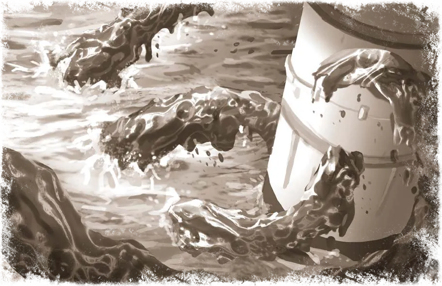

### Угроза лавы

По мере приближения к развязке по буру вверх бьёт лава, заливая буровую площадку раскалённой расплавленной породой. По всей платформе срабатывают сигналы тревоги — если сыщики доберутся до диспетчерской, они увидят происходящее на различных приборах. В противном случае лава растекается по всей нижней палубе, и члены экипажа вскоре приносят сыщикам весть о катастрофе.

Те, у кого есть **Наука (геология)**, могут сделать вывод, что опасность извержения вулкана вполне реальна и что предотвратить его ничем нельзя. Лучший выход — покинуть платформу и убраться как можно дальше… если бы только огромный штормовой фронт не мешал спасению на вертолёте.

Когда произойдёт извержение, решает Хранитель; в идеале оно становится эпической кульминацией, завершающей сценарий (см. «Завершение сценария» рядом).

### Упругий ужас

Бесформенные отродья Цатхоггуа всплывают к платформе, возвещая приход своего хозяина, и взбираются на неё по опорам. Они просачиваются на борт и представляют серьёзную угрозу для всех, кто приближается к спасательным капсулам или пытается убить доктора Ройлотта (если он к этому моменту ещё жив).

Когда они начинают появляться, грозовые тучи над платформой словно сливаются и меняют форму. Тех, кто снаружи или может видеть небо, охватывает ужас: в небе над головой складывается огромный мысленный образ Цатхоггуа. Свидетели этого жуткого образа должны пройти проверку **Рассудка** (0/1d10).

## Завершение сценария

Весьма вероятно, что к концу сценария сыщики погибнут или сойдут с ума, поэтому Хранителю стоит закончить всё громко: бурение Мохола оборачивается эпическим вулканическим взрывом, который уничтожает платформу, убивает всех и всё на борту и, по сути, закрывает дыру в Н’кай, не давая Цатхоггуа явиться. Разумеется, у сыщиков может быть на уме другой финал, поэтому вот несколько возможных решений (и препятствий), если игроки захотят их попробовать.
