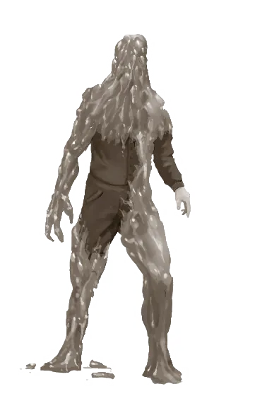

```stat
Бой
Ближний бой (драка)   45% (22/9), урон 1d3
Уклонение             45% (22/9)

Навыки
Бухгалтерия 40%, Искусство/ремесло (кулинария) 80%, Обаяние 70%, Лазание 40%, Электрика 25%, Красноречие 50%, Первая помощь 35%, Слух 25%, Оккультизм 30%, Психология 40%, Ловкость рук 45%, Внимание 30%, Скрытность 30%, Плавание 40%, Метание 50%.
```

### Буровая бригада

- **Руководитель бригады:** Боб Маккрам.
- **Инженер по буровым растворам:** Пит Шед.
- **Верховые:** Рой Бейтс, Ян Андерссон, Барбара Канк.
- **Помбуры:** Флора Макрей, Ангус Макнаб, Джим Рид, Дональд Стюарт, Тайрон Кливер, Лайонел Скотт.

```stat
СИЛ 90    ВЫН 70    ТЕЛ 80    ЛВК 70    ИНТ 65
НАР 35    МОЩ 50    ОБР 55    Рассудок 50   ПЗ 15
БкУ: +1d6   Комплекция: 2   Скорость: 8   ПМ: 10

Бой
Ближний бой (драка)   70% (35/14), урон 1d3+1d6
Уклонение             35% (17/7)

Навыки
Лазание 60%, Подводное плавание 30%, Первая помощь 40%, Запугивание 60%, Прыжки 40%, Механика 55%, Естествознание 50%, Управление тяжёлыми машинами 80%, Психология 40%, Внимание 50%, Скрытность 30%, Плавание 50%, Метание 60%.
```

### Служба охраны

#### Дэвид Шталь, начальник охраны

```stat
СИЛ 75    ВЫН 60    ТЕЛ 80    ЛВК 70    ИНТ 90
НАР 60    МОЩ 45    ОБР 55    Рассудок 36*  ПЗ 15
БкУ: +1d4   Комплекция: 1   Скорость: 7   ПМ: 9

*Под влиянием Цатхоггуа Шталь по ходу сценария сходит с ума.

Бой
Ближний бой (драка)   85% (42/17), урон 1d3+1d4
Автомат HK416         65% (32/13), урон 2d8
Пистолет «Глок» 17    55% (27/11), урон 1d10
Уклонение             60% (30/12)

Навыки
Лазание 65%, Взрывное дело 40%, Подводное плавание 35%, Первая помощь 60%, Запугивание 80%, Прыжки 50%, Юриспруденция 40%, Слух 50%, Медицина 20%, Психология 40%, Внимание 55%, Скрытность 65%, Выживание 45%, Плавание 50%, Метание 60%.
```

*Прим. перев.: так в оригинале — ПЗ 15 при (60 + 80) / 10 = 14.*

#### Люди Шталя

- **Старшие смены:** Джек Денес и Кэл Фукс.
- **Охрана:** Найджел Гордон, Грег Беннингс, Вэнс Норрис, Лем Строуд, Тедди Дойл, Гэри Хант, Кен Лумис, Бадд Алвес.

```stat
СИЛ 70    ВЫН 70    ТЕЛ 80    ЛВК 65    ИНТ 60
НАР 50    МОЩ 50    ОБР 60    Рассудок 50   ПЗ 15
БкУ: +1d4   Комплекция: 1   Скорость: 7   ПМ: 10

Бой
Ближний бой (драка)   70% (35/14), урон 1d3+1d4
Автомат HK416         60% (30/12), урон 2d8
Пистолет «Глок» 17    55% (27/11), урон 1d10
Уклонение             40% (20/8)

Навыки
Лазание 50%, Взрывное дело 30%, Подводное плавание 40%, Первая помощь 50%, Запугивание 60%, Прыжки 50%, Юриспруденция 30%, Слух 50%, Механика 30%, Управление тяжёлыми машинами 40%, Психология 45%, Внимание 50%, Скрытность 60%, Выживание 40%, Плавание 50%, Метание 60%.
```


