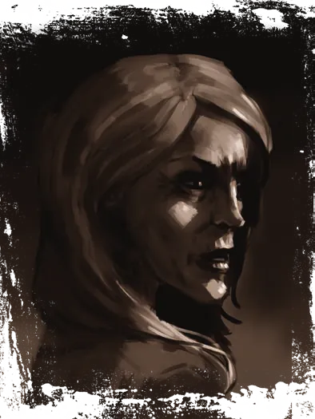

## Готовые сыщики

### Джессика Андерсон



**Возраст:** 48 лет. **Род занятий:** учёная (геохимик) и руководительница команды.

```stat
СИЛ 55    ВЫН 45    ТЕЛ 65    ЛВК 60    ИНТ 80
НАР 60    МОЩ 75    ОБР 90    Рассудок 75   ПЗ 11
БкУ: 0    Комплекция: 0   Скорость: 6   ПМ: 15   Удача: 45

Бой
Ближний бой (драка)   25% (12/5), урон 1d3
Уклонение             30% (15/6)

Навыки
Внимание 65% (32/13)
Естествознание 70% (35/14)
Запугивание 65% (32/13)
Лазание 20% (10/4)
Метание 20% (10/4)
Механика 10% (5/2)
Наука (геология) 80% (40/16)
Наука (математика) 60% (30/12)
Наука (химия) 70% (35/14)
Первая помощь 30% (15/6)
Плавание 20% (10/4)
Прыжки 20% (10/4)
Психология 20% (10/4)
Работа в библиотеке 70% (35/14)
Скрытность 20% (10/4)
Слух 20% (10/4)
Средства 44% (22/8)
Стрельба (винтовка/дробовик) 25% (12/5)
Стрельба (пистолет) 20% (10/4)
Убеждение 40% (20/8)
Язык (английский) 90% (45/18)
Язык (латынь) 30% (15/6)
```

**Бонус:** распределите 30 пунктов между любыми навыками на выбор игрока.

#### Предыстория

Проект «Нергал» — это экспериментальная буровая установка, обустроенная для пробития земной коры и созданная на основании бывшей нефтяной платформы в Северном море. Проект включает сбор и очистку нового источника энергии, названного «ролотный газ» или просто «ролот», который открыл доктор Саймон Ройлотт — руководитель проекта. Проект привлёк большое внимание. Теперь он получает огромное государственное финансирование и поддержку от Джеральда Уайнстепа, министра по вопросам бизнеса, энергетики и промышленной стратегии. Доктор Ройлотт установил ядерный реактор, чтобы запитать буровую установку и позволить ей пробиться на ранее неслыханную глубину. Исполнительный директор проекта — Пирс Голдман, гражданский чиновник, который руководит логистикой и решает все вопросы, не касающиеся науки. Вы — команда экспертов, которую послали провести инспекцию платформы «Дыра дьявола» и определить, оправдывает ли она затраты, безопасна ли она и насколько вероятно, что проект будет успешным. На основании вашего доклада проект либо закроют, либо дадут добро на дальнейшее финансирование. Вам должны беспрекословно предоставить доступ ко всем частям платформы.

- **Описание:** Худая, с седеющими волосами, резкими чертами лица и суровым выражением.
- **Черты:** Въедливая, властная.
- **Идеология/убеждения:** Наука может привести человечество к счастливому будущему, но её не должна касаться политика.

#### Проверяющие

- Вы, учёная (геохимик) и руководительница команды
- Филипп Суонн, учёный (физик-ядерщик)
- Терри Дуглас, океанограф
- Виктор Манн, системный инженер и инженер-технолог
- Триша Хики, кадровый консультант
- Клэрис Уильямс, депутат парламента

*Прим. перев.: лист готового сыщика дан по официальному русскому изданию («Кошмары цифровой эпохи»). В оригинале опечатки долей: «Brawl 25% (12/15)» (верно 12/5) и «Credit Rating 44% (22/9)» (верно 22/8).*
