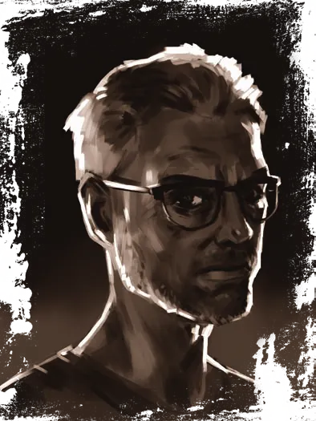

### Филипп Суонн



**Возраст:** 52 года. **Род занятий:** учёный (физик-ядерщик).

```stat
СИЛ 50    ВЫН 70    ТЕЛ 65    ЛВК 65    ИНТ 75
НАР 55    МОЩ 60    ОБР 85    Рассудок 60   ПЗ 13
БкУ: 0    Комплекция: 0   Скорость: 6   ПМ: 12   Удача: 50

Бой
Ближний бой (драка)   25% (12/5), урон 1d3
Уклонение             32% (16/6)

Навыки
Внимание 60% (30/12)
Естествознание 30% (15/6)
Лазание 30% (15/6)
Метание 20% (10/4)
Механика 30% (15/6)
Наука (инженерия) 50% (25/10)
Наука (математика) 60% (30/12)
Наука (физика) 70% (35/14)
Обаяние 45% (22/9)
Первая помощь 30% (15/6)
Плавание 20% (10/4)
Прыжки 20% (10/4)
Психология 15% (7/3)
Работа в библиотеке 40% (20/8)
Работа с компьютером 45% (22/9)
Скрытность 40% (20/8)
Слух 25% (12/5)
Средства 40% (20/8)
Стрельба (винтовка/дробовик) 25% (12/5)
Стрельба (пистолет) 20% (10/4)
Убеждение 40% (20/8)
Электрика 30% (15/6)
Язык (английский) 85% (42/17)
Язык (латынь) 20% (10/4)
```

**Бонус:** распределите 30 пунктов между любыми навыками на выбор игрока.

#### Предыстория

Проект «Нергал» — это экспериментальная буровая установка, обустроенная для пробития земной коры и созданная на основании бывшей нефтяной платформы в Северном море. Проект включает сбор и очистку нового источника энергии, названного «ролотный газ» или просто «ролот», который открыл доктор Саймон Ройлотт — руководитель проекта. Проект привлёк большое внимание. Теперь он получает огромное государственное финансирование и поддержку от Джеральда Уайнстепа, министра по вопросам бизнеса, энергетики и промышленной стратегии. Доктор Ройлотт установил ядерный реактор, чтобы запитать буровую установку и позволить ей пробиться на ранее неслыханную глубину. Исполнительный директор проекта — Пирс Голдман, гражданский чиновник, который руководит логистикой и решает все вопросы, не касающиеся науки. Вы — команда экспертов, которую послали провести инспекцию платформы «Дыра дьявола» и определить, оправдывает ли она затраты, безопасна ли она и насколько вероятно, что проект будет успешным. На основании вашего доклада проект либо закроют, либо дадут добро на дальнейшее финансирование. Вам должны беспрекословно предоставить доступ ко всем частям платформы.

- **Описание:** Стройный, мускулистый, с седеющими волосами, в очках.
- **Черты:** Любит приключения, компанейский.
- **Идеология/убеждения:** Наука может решить все проблемы человечества.

#### Проверяющие

- Вы, учёный (физик-ядерщик)
- Джессика Андерсон, учёная (геохимик) и руководительница команды
- Терри Дуглас, океанограф
- Виктор Манн, системный инженер и инженер-технолог
- Триша Хики, консультант по персоналу
- Клэрис Уильямс, депутат парламента

*Прим. перев.: лист дан по официальному русскому изданию. В оригинале — «Brawl 25% (12/15)» (верно 12/5) и «Charm 45 (22/9)» без знака %; имя в оригинале — Phillip Swann.*
